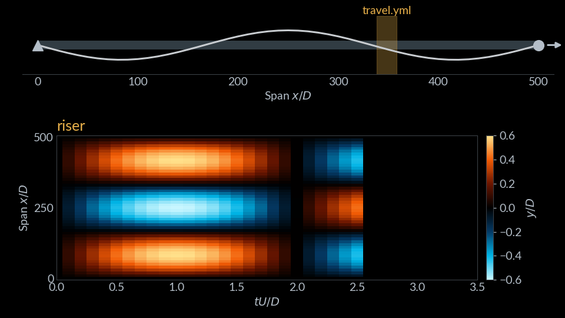
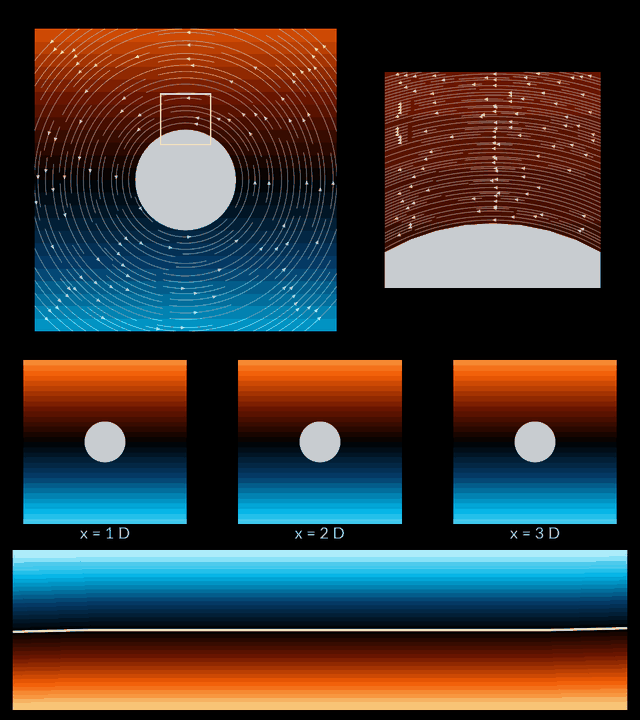

# Panels

A panel is a matplotlib figure drawn once per frame, at that frame's time: plots of
lift moving along with the film, a dot at the current value (plan Section 9.2). A
panel's frames go into a frame folder like a shot's, `OUT/<name>/frame_00000.png`, so a
[layout](layouts.md) tiles them beside the flow.

A runnable example on generated histories is `examples/panels/run.py`; one on a
generated flow is `examples/flow_panels/run.py`.

## A panel file

```yaml
type: series
size: [640, 1080]
times: {shot: shots/bare_wake.yml}
style: styles/film.yml
# ... the keys of the type
```

| Key | Type | Default | Meaning |
|---|---|---|---|
| `type` | `series`, `phase`, `map`, `locator`, `section`, `cuts`, `strip` | required | the kind of panel |
| `name` | string | the file's name without `.yml` | the output folder |
| `size` | `[width, height]` | `[640, 360]` | pixels (the figure is drawn at 100 dots per inch) |
| `times` | list of numbers, or `{shot: FILE}` | required | the time of each frame |
| `style` | mapping, file, or `{from: FILE, ...}` | the defaults below | how it looks |

**Times.** Frame *i* is drawn at `times[i]`, in the source's time unit. With
`{shot: FILE}` the times are those of the shot's frames, the time of the step each
frame shows. A panel and a shot with the same times then line up frame by frame in a
layout. A list must not decrease. A layout can also tile a panel itself (`panel:
FILE`), and draw it at the film's output rate, between flow frames
([layouts](layouts.md#panels-at-the-output-rate-rate-output)).

## Style

One style block is shared by every panel of a film, so all plots match. Put it in its
own file and name it from each panel: `style: styles/film.yml`. To change a few values
for one panel, write `style: {from: styles/film.yml, font_size: 20}`.

| Key | Type | Default | Meaning |
|---|---|---|---|
| `font` | string | `Lato` | text font family; the bundled Lato is always available |
| `font_size` | number | `17` | points; at 100 dots per inch a point is 1.39 pixels |
| `maths` | `dejavusans`, `dejavuserif`, `cm`, `stix`, `stixsans` | `dejavusans` | font for text between `$`, such as `'$C_L$'` |
| `background` | colour | `black` | the figure and the axes |
| `text` | colour | `'#b4bec8'` | labels and tick numbers |
| `grid` | colour | `'#3a4046'` | grid lines and the axes' edges |
| `line_width` | number | `2.2` | points |
| `grid_width` | number | `0.8` | points |
| `dot_size` | number | `8` | the current-time dot's diameter, points |
| `colours` | list of colours | five film colours | given in turn to lines that name none |
| `pad` | number | `0.12` | share of a data range added above and below, for ranges found from the data |

The defaults are the AFMS film's plots. Maths uses DejaVu Sans rather than Lato because
Lato has no maths glyphs; DejaVu Sans sits well beside it.

## Where the data comes from

The `series`, `phase`, `map` and `locator` panels read time histories declared for bodies
under the body's `series` ([bodies](../projects/bodies.md)), in the tags of the project
(the nearest `flowreel.yml` at or above the panel file) or in `flowreel.yml` itself. A
line names its series and, unless one body declares a series of that name, its body. A
tag's body is `tag.body` (`smooth.cyl`), or its own name when no other tag has it
([bodies across tags](../projects/data.md#shots-and-panels-name-a-tag)):

| Key | Type | Default | Meaning |
|---|---|---|---|
| `series` | string | required | the series' name under the body |
| `body` | string | the one body with that series | the declared body: `tag.body`, or its name when only one has it |
| `column` | string | the series' only value column | the column, as renamed by `columns` |
| `scale`, `offset` | number | `1`, `0` | the value drawn is `value * scale + offset` |
| `label` | string | none | the line's name in the legend |
| `colour` | colour | the style's colours in turn | |

A series at many points (`by: node`) is not a line; the `map` and `locator` panels
draw those.

## `series`

```yaml
type: series
size: [640, 1080]
times: {shot: shots/bare_wake.yml}
x: {label: '$tU/D$', range: [0, 100]}
rows:
  - label: 'Mid-span $y/D$'
    lines:
      - {body: bare, series: motion, column: y, label: bare}
      - {body: helical, series: motion, column: y, label: helical}
  - label: '$C_L$'
    range: [-1.5, 1.5]
    lines:
      - {body: bare, series: force, column: cl}
      - {body: helical, series: force, column: cl}
margins: {left: 0.2, right: 0.95, top: 0.93, bottom: 0.08, space: 0.18}
```

Rows of axes, top to bottom, share one time axis. Each line runs from the start of its
series to the frame's time and ends there at a dot. Between two samples, the line's end
and the dot are at the value interpolated linearly between them. So a panel drawn at
times between the saved samples moves smoothly instead of jumping from sample to
sample. Before the first sample and after the last, the value is held.

| Key | Type | Default | Meaning |
|---|---|---|---|
| `x` | `{label, range}` | the panel's first to last time | the shared time axis |
| `rows` | list of `{label, range, lines}` | required (or `y` and `lines` for one row) | |
| `rows[].range` | `[low, high]` | from all its lines' values, padded by `pad` | |
| `rows[].lines`, `lines` | list of lines ([where the data comes from](#where-the-data-comes-from)) | required | the row's lines; `lines` alone with `y` for a panel of one row |
| `legend` | bool | `true` | the first row's labelled lines, in their colours, above it |
| `margins` | `{left, right, top, bottom, space}` | `0.18, 0.95, 0.86, 0.16, 0.18` | axes' edges as shares of the figure; `space` between rows, as a share of a row's height |

A range found from the data covers the whole series, not only the part drawn so far,
so the axes do not move during the film. Line *j* of every row takes the style's colour
*j*, so a case keeps its colour from row to row.

## `phase`

```yaml
type: phase
size: [400, 400]
times: {shot: shots/pendulum.yml}
x: {body: riser, series: motion, column: y, label: '$y/D$'}
y: {body: pendulum, series: swing, column: angle, label: '$\theta$', range: [-0.5, 0.5]}
colour: '#d8707a'
```

One history against another: the trace up to the frame's time and a dot at the current
values. The trace takes a point at every sample time of either series before the
frame's time, each value interpolated, so two series sampled at different times still
pair up correctly.

| Key | Type | Default | Meaning |
|---|---|---|---|
| `x`, `y` | a line's keys (no `colour`) with `label` and `range` | required | the two histories and their axes |
| `colour` | colour | the style's first | |
| `margins` | `{left, right, top, bottom}` | as for `series` | |

## Histories along a long body: `map` and `locator`



These two read a history at many points along a body: a series declared with `by` (the
column that numbers the points) and `stations` (where each point is along the body),
such as the riser's probes ([bodies](../projects/bodies.md), [long bodies](../rendering/long-bodies.md)). A
runnable example on the generated riser case is `examples/riser500/panels.py`, which
drew the picture above.

### `map`

```yaml
type: map
size: [1920, 1080]
times: [0, 0.05, 0.1]
x: {label: '$tU/D$'}
y: {label: 'Span $x/D$', ticks: [3, 6, 9]}
rows:
  - {body: bare, series: lift, column: cl, title: bare}
  - {body: helical, series: lift, column: cl, title: helical}
colormap: fire_ice
range: [-1.5, 1.5]
colorbar: {label: 'Sectional $C_L$'}
```

The history against time (across) and station (up), one cell per sample, coloured. At
each frame the samples up to that time are shown and the later ones are left out, so
the map fills in from the left. It moves from sample to sample; unlike the lines of a
`series` panel, it does not interpolate between them. Several bodies stack as rows on
one time axis, under one colour bar.

| Key | Type | Default | Meaning |
|---|---|---|---|
| `rows` | list | required | one per body: `body`, `series`, `column`, `scale`, `offset`, `title`, `colour` |
| `rows[].title` | string | none | over the row, on the left, in the row's `colour` |
| `rows[].colour` | colour | the style's colours in turn | the title's colour |
| `x` | `{label, range}` | the samples' first to last time | the time axis |
| `y` | `{label, range, ticks}` | the stations | the span axis; `ticks` a list of stations |
| `colormap` | string | `fire_ice` | `fire_ice` (black at the middle) or a matplotlib name |
| `range` | `[low, high]` | `[-a, a]`, `a` the largest magnitude | the colours' range |
| `colorbar` | `{label, fraction, pad}` or `false` | `{fraction: 0.025, pad: 0.02}` | matplotlib's colour bar settings |
| `title_size` | number | 1.3 times the style's `font_size` | points |
| `margins` | as for `series` | as for `series` | |

The default range is symmetric about zero, so a diverging map such as `fire_ice` has
its middle colour at zero: a sign change of lift reads as a change of hue. Without
declared `stations`, the point numbers stand in for them.

### `locator`

```yaml
type: locator
size: [1920, 200]
times: {shot: travel.yml}
body: riser
shape: {series: displacement, column: dy, amplify: 100}
windows: [{shot: travel.yml, label: window}]
x: {label: 'Span $x/D$'}
```

Where we are along a long body. The span is a grey bar from the first to the last
declared end. Over it are the body's shape at the frame's time, the supports, and the
window each named shot shows. A film that travels along a riser 500 diameters long
needs this to say where the window is.

| Key | Type | Default | Meaning |
|---|---|---|---|
| `body` | string | required | a declared body with an `axis` |
| `shape` | `{series, column, scale, offset, amplify, colour}` | none | the body's displacement history at many points |
| `shape.amplify` | number | `1` | the displacement is drawn this many times larger |
| `supports` | bool | `true` | the declared ends: pinned ▲, roller ●, clamped ■, spring ✕, prescribed ◆, free only with `mark`; `tension` adds an arrow |
| `windows` | list of `{shot, colour, label}` | none | shots whose crops are marked |
| `colour` | colour | the body's grey | the shape's line |
| `x` | `{label, range}` | the ends, plus 3% each side | |
| `y` | `{range}` | 1.4 times the largest amplified displacement | the displacement axis (no ticks) |
| `margins` | as for `series` | `left 0.04, right 0.98, top 0.85, bottom 0.3` | |

- **Shape.** At each frame, the value at each station is interpolated in time,
  then multiplied by `amplify`. A displacement of a diameter along 500 diameters
  cannot be seen otherwise. The y axis has no ticks because its numbers would be the
  amplified ones.
- **Windows.** Frame *i* marks the window of frame *i* of each shot: the crop's
  extent along the body's axis. A `crop: {around: ...}` travels with its station
  track; a crop box stays where it is. Frames are matched by index, as in a layout,
  because a frozen shot's frames all have one time. Past a shot's last frame, the
  window stays where the shot ends. The windows are worked out from the shot files
  alone; no flow data is read.
- The body needs declared `ends`, or a `shape` (its stations), or an `x` `range`, so
  that its span is known.

## Panels from flow data: `section`, `cuts` and `strip`



These three read the flow itself, not histories. A runnable example on a generated case
(a cylinder moving across a ring of flow whose fields are known exactly) is
`examples/flow_panels/run.py`, which drew the picture above.

### Where the flow comes from

| Key | Type | Default | Meaning |
|---|---|---|---|
| `source` | as a shot's `source`: a tag, or the files | the source of the shot in `times: {shot: FILE}` | the flow to read; a tag brings its units as the field's parameters; relative paths from the panel file's folder |
| `body` | string | the one body | the body, by its name in `flowreel.yml` or its zone |
| `field` | string | required | a field the source gives (`U`, `p`) or a derived one (`vorticity_x`, `lambda2`, ...; see [fields](../projects/fields.md)) |
| `params` | mapping of numbers | the project's [`reference`](../projects/project.md#reference-values) values the field takes | parameters of derived fields: `{rho: 1, u_inf: 1}` for `pressure_coefficient`, `{mu: 0.001}` for `wall_shear`; a value here wins over the project's |
| `range` | `[low, high]` | required | the colours' range; values outside it take the end colours |
| `colormap` | string | `fire_ice` | `fire_ice` (black at the middle) or a matplotlib name |
| `levels` | integer | `41` | contour levels from `low` to `high` |
| `view` | `[left, bottom, width, height]` | the whole panel | where the picture is, as shares of the figure |

- **Steps, not times.** Frame *i* shows the saved step whose time is nearest `times[i]`
  (the earlier one at a tie). Flow is never interpolated between steps: two frames
  between the same pair of steps show the same flow, and are drawn once.
- **A range must be given.** A range found from each frame's data would change from
  frame to frame, and a colour would not mean one value through the film.
- **Derived fields are computed before the cut,** on the volume read round it, so a
  gradient across the plane is a true one. Velocity and pressure are all that is read
  (plan Section 6); pressure only when the field needs it.

### Cuts across a body

`section` and `cuts` cut the flow across a body: the plane normal to the body's axis
(declared in `flowreel.yml`, or its long axis), at a station along it. Only a slab of
the step round the cut is read: `depth` each side of the plane, and the view plus
`depth` in the plane. The slab is the source's crop, so a PLT file is read through a
window ([long bodies](../rendering/long-bodies.md)), and a cut of a riser 500 diameters long reads
a few diameters of it. A cell is read when it lies wholly in the slab, so `depth` must
be larger than a cell; a cut that finds no cell says so.

| Key | Type | Default | Meaning |
|---|---|---|---|
| `axes` | two of `x`, `y`, `z` | the other two axes, in the order x, y, z | the plane's axes across and up the picture: `[z, y]` puts a flow along z to the right |
| `half` | number or `[across, up]` | 1.5 diameters | half-size of the view, length unit |
| `centre` | `[across, up]` | the body's centre at the station, in each frame | a view that stays put, in the source's coordinates |
| `depth` | number | 1 diameter | half-thickness of the slab read, length unit |
| `body_colour` | colour | `'#c8ccd0'` | the bodies' fill |

Every wall body that crosses the plane is drawn, filled; the view follows the named
one.

### `section`

```yaml
type: section
size: [1920, 1080]
times: {shot: travel.yml}
body: riser
station: 250
field: vorticity_x
range: [-30, 30]
half: 1.4
inset: {offset: [0.2, 0.45], half: 0.3}
```

One cut: the field as filled contours, streamlines of the flow seen from the body, the
body's outline, and an inset, a close view that follows the body, with its box drawn
on the main view (the prototype's groove section).

| Key | Type | Default | Meaning |
|---|---|---|---|
| `station` | number or track | required | where along the body to cut; a track (keyed on frames) travels |
| `streamlines` | mapping or `false` | on, as below | |
| `streamlines.relative` | bool | `true` | take away the body's velocity |
| `streamlines.density` | number | `1.6` | matplotlib's `streamplot` density in the main view |
| `streamlines.colour`, `.opacity`, `.width`, `.arrow` | | `'#ffffff'`, `0.55`, `0.7`, `0.8` | width in points; `arrow` is the arrow size |
| `streamlines.resolution` | integer | `200` | points each way of the grid the velocity is taken to |
| `inset` | mapping or none | none | the close view |
| `inset.offset` | `[across, up]` | `[0, 0]` | its centre, from the body's centre, length unit |
| `inset.half` | number or pair | 0.2 diameters | its half-size |
| `inset.at` | `[left, bottom, width, height]` | `[0.58, 0.2, 0.38, 0.6]` | where it is in the figure; the main view moves to `[0.04, 0.08, 0.5, 0.84]` |
| `inset.density` | number | `2.4` | streamline density in the inset |
| `inset.box` | colour | `'#f2f2f2'` | its box on the main view |

**Flow seen from the body.** A vibrating cylinder carries the flow next to it, so
streamlines in the frame of the mesh show the body's motion more than the flow round
it. With `relative: true` the body's velocity at the station is taken away first. It
is found from the body's centre at the station at the saved steps either side, divided
by their time apart (one-sided at the first and last step), so no solver output beyond
the flow files is needed. Inside the bodies the streamlines are masked.

### `cuts`

```yaml
type: cuts
size: [1920, 540]
times: {shot: travel.yml}
body: riser
stations: [125, 250, 375]
field: vorticity_x
range: [-2.5, 2.5]
centre: [3.5, 0]
half: [5, 4.2]
label: 'x = {station:g} D'
```

The same cut at several stations, side by side and labelled, so the phase of shedding
can be read along the span (the prototype's span slices). Each view follows the body
at its own station, or every view stays at `centre`.

| Key | Type | Default | Meaning |
|---|---|---|---|
| `stations` | list of numbers | required | one cut each, left to right |
| `label` | string or `false` | `'station {station:g}'` | under each cut; `{station}` is replaced by the station |
| `gap` | number | `0.008` | space between cuts, share of the figure's width |

Each station is read on its own, through its own window. A source that cannot read a
window (a VTU file) is read whole once per station, so keep such panels to few
stations.

### `strip`

```yaml
type: strip
size: [1920, 540]
times: {shot: travel.yml}
body: riser
side: y
field: skin_friction
component: z
params: {rho: 1, u_inf: 1, mu: 0.0001}
range: [-0.03, 0.03]
```

The body seen from one side, its span across, coloured by a field on the wall, with
the line where the field is zero (the prototype's separation line: streamwise skin
friction changes sign where the flow leaves the wall).

| Key | Type | Default | Meaning |
|---|---|---|---|
| `side` | `x`, `-x`, `y`, `-y`, `z`, `-z` | required | the side the eye is on; not the body's axis |
| `component` | `x`, `y`, `z` | none | the part of a vector field drawn; required for one |
| `span` | `[low, high]` | the whole body | the part of the span shown, along the body's axis |
| `zero` | `{colour, width}` or `false` | `{colour: '#f2f2f2', width: 2.5}` | the zero line; width in points |
| `margin` | number | half a diameter | the flow read round the body, length unit |
| `aspect` | `auto` or `equal` | `auto` | `equal` keeps lengths true; `auto` fills the panel, which a long body needs |

- **The field** is an array the source gives on the wall (`p`), a wall field
  (`wall_shear`, `skin_friction`, `wall_pressure`, `wall_traction`; per wall cell,
  averaged to the points), or a flow field sampled on the wall (`speed`). Wall fields
  are computed from the flow inside the body's box grown by `margin`, which must hold
  the cells next to the wall. Their sign convention is in [fields](../projects/fields.md): wall
  shear points the way the fluid next to the wall moves relative to it.
- **One side.** Only the half of the body facing the eye is drawn: the triangles whose
  centre lies on the eye's side of the body's centre at their station.
- **A true view.** The span runs left to right and the picture is not mirrored, so the
  up direction follows from the side: seen from `+y` with the span along x, up is
  `-z`; seen from `-y`, up is `+z`.

## Drawing: `compose.panel`

```python
from flowreel import compose

report = compose.panel("panels/lift.yml", "frames", jobs=4)   # frames/lift/frame_00000.png ...
print(report.count("drawn"), report.count("skipped"))
```

| Argument | Meaning |
|---|---|
| `pf` | a panel file or a loaded `PanelFile` |
| `out` | folder of frame folders (default `frames`) |
| `times` | draw at these times, not the panel's own |
| `frames` | only these frames |
| `jobs` | processes; each draws a run of consecutive frames |
| `force` | draw every frame again |

The figure is built once per process and only moved along in time. Building the axes,
reading the data and laying out the text cost far more than moving a few lines, and a
panel's frames differ only in time. So the frames are split into `jobs` runs of
consecutive frames, one process each.

**Keys.** Each frame has a key (plan Section 11): the panel's type, size and settings,
the style, the frame's time, and the path, size and modification time of each series
file the panel reads (for a locator, also each window's shot file; for a flow panel,
the source's files for every step and `flowreel.yml`). A frame drawn
before with the same key is skipped. Moving one
time redraws one frame. Rewriting a series file, or changing the style, redraws them
all.
