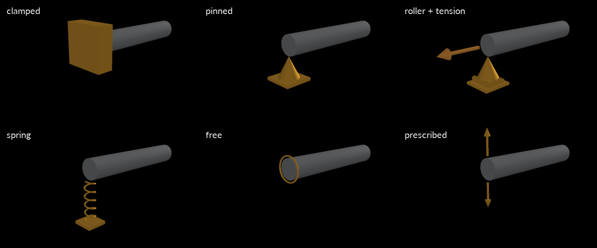

# Bodies

A source's files say where a body's surface is and nothing else: not which way its span
runs, how thick it is, or how its ends are held. FlowReel does not look for that in the
solver's other files. It is written once, under `bodies:` in the case's
[`domain.yml`](data.md#domainyml) (`data/<tag>/domain.yml`), and every shot and panel of
that tag uses the body by its name; across tags it is `tag.body`.

Every body is a surface zone of the source (for `plt`, a surface zone of the PLT
file). A slender one, given an `axis`, is a **beam body**: it has a span, a diameter,
stations and supports. Any other body (a ball, a wall) has a name, a zone and series
only.

Code: `flowreel.project` (`load_project`, `find_project`), `flowreel.project.bodies`
(the records), `flowreel.project.names` (names in shots), `flowreel.project.measure`
(centre, centreline, diameter). A runnable example on generated data is
`examples/bodies/run.py`.

## Where bodies are declared

Under `bodies:` in a tag's `domain.yml`. A shot of the tag (`source: bare`) sees them by
their names; a panel of series sees every tag's, as `tag.body` where two tags meet
([bodies across tags](data.md#shots-and-panels-name-a-tag)). Series paths are taken from
the tag's folder (`series/force.csv`).

```yaml
bodies:
  riser:
    zone: cyl                      # surface zone in the source; default: the body's name
    axis: x                        # span direction; leave out for a body that is not slender
    diameter: 1.0                  # reference length
    ends:
      - {at: 0.0, support: pinned}
      - {at: 500.0, support: roller, free_along: x, tension: true}
    series:
      displacement: {file: data/riser_disp.csv, by: node, stations: data/riser_nodes.csv}
      force: data/riser_force.csv
  downstream:
    zone: cyl2
    axis: x
    ends: [{at: 0.0, support: clamped}, {at: 12.0, support: clamped}]
```

`flowreel data import` writes this block with one body per surface zone, its axis and
diameter measured, and the supports left to fill
([bringing a case in](data.md#bringing-a-case-in)).

## A body

| Key | Type | Default | Example |
|---|---|---|---|
| `zone` | the source's surface zone (a name from `source.bodies()`) | the body's name | `zone: cyl` |
| `axis` | `x`, `y` or `z`: the span direction; makes it a beam body | none: not a beam | `axis: x` |
| `diameter` | positive number, source length unit: symbols and stations scale with it; beam bodies only | measured from the surface when needed | `diameter: 1.0` |
| `ends` | list of supports (below); beam bodies only | none | `[{at: 0, support: clamped}]` |
| `series` | mapping of series names to CSV files (below) | none | `force: data/force.csv` |

Two bodies cannot share a zone. Lengths are in the source's own unit, and a station is a
plain number along the axis, not a formula.

## Names in shots

With a project, a body name in a shot is a declared name. It reaches the source as the
body's `zone`, so a layer's `body: riser`, a camera's `follow: riser` and
`source.body(step, "riser")` (as wall fields take it) all read zone `cyl`.

- **No declaration is needed to draw a body.** Zones that no body claims keep their own
  names, as without a project.
- **A name may be left out** where one body is meant: `follow: true` takes the only
  declared body, or else the source's only zone. With several, FlowReel asks for a name.
- A wrong name is reported with the names there are and the nearest one.
- A body layer's default `body: all` still draws every zone.
- The declarations are part of every frame's key: give `riser` another zone and the
  frames that show it are drawn again.

From Python, `Scene.make`, `render` and `render_frame` find the project themselves from
the shot file. For a shot built in code, pass the source wrapped:
`flowreel.project.names.declare(source, load_project("films/afms"))`.

## Virtual bodies

Some structures are solved as equations coupled to the flow and never meshed: a pendulum
hung from a cylinder, a tuned mass, a spring to ground. The files have no surface for
them; their motion is in the solver's time series. A virtual body is drawn from a
**shape** whose parameters are fixed in `params` or **driven** by series:

```yaml
bodies:
  riser: {zone: cyl, axis: x, diameter: 1.0}
  pendulum:
    virtual: true
    shape: pendulum                          # rod and bob
    params: {length: 2.0, bob: 0.3, swing: [1, 0, 0]}
    attach: {body: riser, station: 250.0}    # its origin follows the riser there
    drive:
      angle: {series: swing, column: pendDisp}
    series:
      swing: data/pendulum.csv               # FlexFlow Analyzer's export of pendDisp
```

| Key | Meaning | Default |
|---|---|---|
| `virtual` | `true` | required |
| `shape` | a registered body function: `pendulum`, `spring`, `mass`, or a plugin's | required |
| `params` | the shape's parameters, fixed | the shape's defaults |
| `attach` | `{body: NAME, station: S}` (that body's centre at the station; without `station`, its centre), or `{point: [x, y, z]}`; either with `offset: [dx, dy, dz]` | `{point: [0, 0, 0]}` |
| `drive` | the shape's parameters as [series tracks](../shots/tracks.md#series-as-a-track); `body` defaults to this virtual body | none |
| `series` | its CSV series, as for any body | none |

- **Nothing is computed.** FlowReel draws the solver's result at each step's time: it
  does not integrate the pendulum's equation. What the numbers mean (an angle or a
  length, the pivot, the plane of swing) is stated in `params` and `attach`; FlowReel
  does not guess it from the file.
- **It moves with its host.** The origin is the host body's centre at the station in
  that step, so a pendulum hangs from a vibrating riser.
- **Drawn to look modelled, not meshed.** A `body` layer of virtual bodies draws them as
  a `ghost` (see-through, outlined) unless it gives `style`, so the film does not
  suggest the pendulum disturbed the flow as a solid would.
- **No wall.** A virtual body is not in the flow: a `field` on it, an `iso` `gap_body`
  or a `slice` `mask_body` naming it is an error. Without a name, "every body" means
  the bodies with a surface, so wall gaps never count a pendulum.
- `follow` may follow a virtual body by name; `follow: true` means the one body with a
  surface.

| Shape | Parameters (lengths in the source's unit, angles in radians) |
|---|---|
| `pendulum` | `length` (pivot to the bob's centre), `bob` (its radius), `rod` (radius), `angle` (from hanging along `down`, about the `swing` axis), `down`, `swing` |
| `spring` | `length` (drive it to stretch), `radius` (of the coil), `turns`, `wire` (radius), `direction` |
| `mass` | `size` (edge), `x`, `y`, `z` (the centre from the origin; drive one with a displacement) |

A shape is a registered body function (`flowreel.sources.bodies.register_body`), so a
new mechanism is a small plugin. `examples/bodies/shots/pendulum.yml` hangs a pendulum from
the riser at mid-span and swings it from a generated `pendDisp` series.

## Stations, centre and diameter

Where a body has an `axis`, its **centre at a station** is the mean of the surface
points within a thin slab of the station, so `follow` (and later `supports` and
`centreline`) work on a bent and moving body. Stations belong to beam bodies. The slab is a quarter of the declared
diameter; without one, 2% of the body's length but no more than a quarter of its width,
so a body 500 diameters long is cut into thin slices and not slabs 10 diameters wide.
`follow` takes its axis from the declaration unless the camera gives `axis`.

The **diameter** measured from the surface (by `project init`, and where a declaration
leaves it out) is twice the median distance of a section's points from the section's
own axis, taken as the median over sections along the span. Medians make grooves,
strakes and the ends count for little: the grooved cylinder of the carving shot
measures 1.0, its bare diameter. `project init` makes a zone a beam body, with an
`axis` and a measured `diameter`, when it is at least three times longer in one
direction than across; other zones get neither.

| Function | Gives |
|---|---|
| `measure.centre(surface, station, axis)` | the section's centre, `(x, y, z)` |
| `measure.centreline(surface, axis, stations=None, count=33)` | `(stations, centres)`, centres `(n, 3)` |
| `measure.diameter(surface, axis)` | the diameter (without `axis`: the bounding box's smallest side) |
| `measure.long_axis(surface)` | `x`, `y`, `z` or `None` |

## Supports

How the solver holds the structure is not in its files. It is written under the body's
`ends`, each at a station along the axis. A support may also sit along the span.

| `support` | Fixes | Its own keys |
|---|---|---|
| `clamped` | position and slope | |
| `pinned` | position; the body may turn | |
| `roller` | position across `free_along`; slides along it | `free_along: x` (required) |
| `spring` | nothing; restrained by `stiffness` | `stiffness: 20` (required, positive) |
| `free` | nothing | `mark: true` draws a thin ring |
| `prescribed` | moved by the solver along `direction` | `direction: y` or `[0, 1, 0]` (required) |

Any support takes `tension: true`, for a riser held by top tension. Two supports cannot
share a station.

| Key of an end | Type | Default | Meaning |
|---|---|---|---|
| `at` | number, length unit | required | the station along the axis |
| `support` | one of the supports above | required | how the body is held there |
| `tension` | bool | `false` | held by top tension (a riser) |
| `free_along` | `x`, `y` or `z` | required for `roller` | the direction a roller slides |
| `stiffness` | positive number | required for `spring` | the spring's stiffness |
| `mark` | bool | `false` | `free`: draw a thin ring at the station |
| `direction` | axis or `[x, y, z]` | required for `prescribed` | the direction the solver moves it | The `supports` layer draws them ([layers](../shots/layers-markers.md#supports)):



A new kind is a symbol function registered with
`flowreel.scene.supports.register_support(name, keys=..., required=...)`, which also
lets a body's `ends` accept it with its own keys.

## Series

A body's time histories are CSV files, whatever wrote them. A file is given by path
alone (`force: data/force.csv`) or with these keys:

| Key | Meaning | Default |
|---|---|---|
| `file` | the CSV, relative to the project folder; may hold `{node}` (the `by` name in braces) for one file per point | required |
| `time` | name of the time column | `time` |
| `columns` | names to use for columns, `{dy: aleDisp_y}` (new name: name in the file) | the file's own |
| `by` | a column numbering the points along the body (`node`), for a history at many points | none: one row per time |
| `stations` | where those points are: a list of numbers (in the order of the sorted point numbers), or a CSV with the `by` column and a `station` column; needs `by` | none |

```python
from flowreel.scene.rendering import Scene
source = Scene.make("shots/riser.yml").source     # the shot's source, with the project's bodies
lift = source.series("force", body="riser")       # time, then the values
disp = source.series("displacement")              # the one body that declares it
```

`series(name, body=...)` reads the CSV declared under that body, once per process.
Without `body` it takes the one declared body with a series of that name, or else the
source's own series (the `plt` adapter reads FlexFlow's OTHD and OISD files: a quick
look at a one-body FlexFlow case, not the way to declare a series). The result is
a `pandas.DataFrame`: `time` first, in ascending order, then (with `by`) the point
number and `station`, then the value columns. Where a restart repeats a time, the
later row wins. A missing file or column is reported with the file's name and the
columns it has.

### Computed from the flow

A body's sectional force along its axis can be computed by FlowReel itself, from the flow
next to the wall: `flowreel data extract sections TAG` writes it into the tag and
declares it under the body ([series from the flow](data.md#series-from-the-flow-data-extract)).

### From a FlexFlow case's OTHD and OISD files

In a project with tags, `flowreel data import history --path CASE --tag TAG` reads the
case's `othd_files/` and `oisd_files/` and writes each group as CSV under the tag's
`series/`, declared under its body: no export needed
([histories from FlexFlow](data.md#histories-from-flexflow)). The rest of this section is
for CSV written by FlexFlow Analyzer itself.

### Exporting from FlexFlow Analyzer

For a FlexFlow case, the series come from FlexFlow Analyzer's `data table`, which handles
restarts, the groups of several bodies (`--othid`, `--osgid`) and the pendulum's lines.
It writes `tsId, time, <variables>`, which FlowReel reads as it is:

```text
data table CASE --var totTrac_x,totTrac_y --osgid 0 --output data/riser_force.csv   # force
data table CASE --var aleDisp_y --othid 0 --node 24 --output data/riser_disp_24.csv
```

A history along the span (every probe node) is one file per node today, so declare the
file with `{node}` and give the stations:

```yaml
series:
  displacement:
    file: data/riser_disp_{node}.csv      # riser_disp_0.csv, riser_disp_1.csv, ...
    by: node
    stations: data/riser_nodes.csv        # node, station
    columns: {dy: aleDisp_y}
```

A single long-form export of all nodes (one file with a `node` column) is asked of the
Analyzer; it reads with `file: data/riser_disp.csv` and the same `by`.

FlowReel's own OTHD and OISD readers refuse a file that holds more than one group, so
two bodies' rows are never mixed: export each group as above instead.
