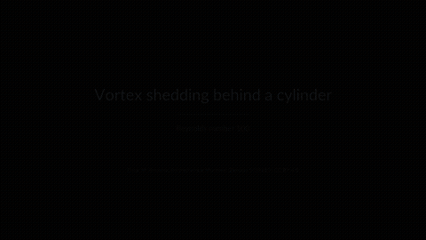

# FlowReel

FlowReel makes films of flow simulations from configuration files. Each shot (the data,
the fields, the layers, the camera) is a YAML file. FlowReel renders the frames, on a
laptop or on a cluster, and builds the film from one more file, with its cards,
captions, freezes and sound. Every picture can be made again from the files that
describe it.


## Where to start

**[The tutorial](tutorial/index.md)** makes a 20-second film of the flow past a
cylinder from a public data set, in eight short chapters, from installing FlowReel to
the finished film. Start there.

**[The second tutorial](tutorial/unsteady/index.md)** films a flow that moves: vortex
shedding behind a cylinder at a Reynolds number of 100, read from PLT files, with the
drag and lift drawn beside it from a CSV file, and rendered on a cluster. It follows
the first.



## The user guide

Each part of FlowReel, in the order a film is made:

| Part | Pages |
|---|---|
| Projects and data | [projects](project.md), [the rules](rules.md) every project follows, [sources](sources.md) of data, [bodies](bodies.md), [derived fields](fields.md) |
| Shots | [shot files](shots.md), [flow layers](layers-flow.md), [layers without flow data](layers-markers.md), [tracks](tracks.md) (values that change along a shot), [cameras](cameras.md), [the camera editor](camera-editor.md) |
| Rendering | [rendering and caching](rendering.md), [long bodies](long-bodies.md), [Slurm](slurm.md) |
| Composing | [compose](compose.md), [layouts](layouts.md), [panels](panels.md) |
| The film | [the film file](film.md), [captions and shapes](captions.md), [cards](cards.md), [clips](clips.md), [building the film](build.md) |

## The reference

- **[Commands](reference/commands.md):** every command and option, from the commands'
  own help.
- **[YAML keys](reference/yaml.md):** every key of every file FlowReel reads, with its
  type and default, linked to the guide page that explains it.

Both are generated from the code, so they cannot drift from it.

## This site

The site is built from the Markdown pages in `docs/` with
[MkDocs Material](https://squidfunk.github.io/mkdocs-material/), and published to
<https://arunperiyal.github.io/FlowReel/> on every change to `main`. The same pages read
on GitHub, without the site's search and navigation. To build it on your machine:

```text
pip install -e ".[docs]"
mkdocs serve            # the site at http://127.0.0.1:8000, rebuilt as you edit
mkdocs build --strict   # as every pull request does: a broken link or anchor, or a
                        # page left out of the navigation, fails it
```

A new page goes in the `nav` of `mkdocs.yml`. The design, `docs/PLAN.md`, stays out of
the site. FlowReel is open source (MIT) on [GitHub](https://github.com/arunperiyal/FlowReel).
