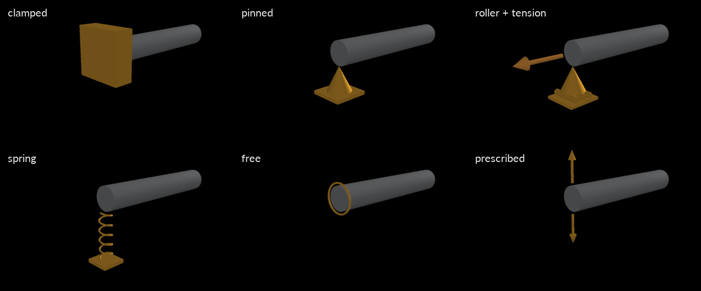

# Layers without flow data: `outline`, `glyphs`, `markers3d`, `geometry`, `supports`

Code: `flowreel.scene.marker_layers` (`supports`: `flowreel.scene.supports`). Entries of a shot's `layers:` list
(`docs/shots.md`). *Track* options take a number or keys (`docs/tracks.md`). Colours are
hex strings; lengths and positions are in the source's unit; line widths in pixels. None
of these needs the flow, except `glyphs` with `direction: velocity`; a shot made only of
them (such as one on a `geometry` source) loads no flow.

## Boxes: `bounds` and `in`

A box is `domain` (the source's bounds), `crop` (the shot's crop; the domain when the shot
has none) or numbers `{x: [lo, hi], y: [lo, hi], z: [lo, hi]}` with `lo < hi`.

## `outline`

The twelve edges of a box.

| Key | Type | Default | Example |
|---|---|---|---|
| `bounds` | a box | `domain` | `crop` |
| `colour` | track, colour | `#ffffff` | `"#8899aa"` |
| `width` | track, pixels | `1` | `2` |
| `opacity` | track | `1` | `{from: 0, to: 1, frames: [0, 24]}` |

## `glyphs`

Arrows on a face of a box, or at points.

| Key | Type | Default | Example |
|---|---|---|---|
| `where` | see below, required | | `{face: z-, grid: [8, 4]}` |
| `direction` | track, vector, or `velocity` | `[1, 0, 0]` | `[0, 1, 0]` |
| `size` | track, arrow length | `1` | `0.5` |
| `colour` | track, colour | `#ffffff` | `"#f25c05"` |
| `opacity` | track | `1` | `0.8` |

`where` is either `{face: F, grid: [n, m], in: box}` or `{points: [[x, y, z], ...]}`.
`F` is `x-`, `x+`, `y-`, `y+`, `z-` or `z+`: the face of the box `in` (default `domain`).
The `n x m` arrows sit at the centres of the grid cells; the grid runs along the face's
other two axes in x, y, z order (for `z-`, `n` along x and `m` along y). `direction:
velocity` points each arrow along the local flow, sampled at its position (needs the flow;
arrows where the flow is zero are left out). Arrows have the same length, `size`;
the direction is the information.

## `markers3d`

One solid marker at a position; use one layer per marker.

| Key | Type | Default | Example |
|---|---|---|---|
| `shape` | `arrow3d`, `block`, `sphere`; required | | `sphere` |
| `at` | track, vector; required | | `{from: [0, 1, 0], to: [6, 1, 0], frames: [0, 24]}` |
| `colour`, `opacity` | tracks | `#ffffff`, `1` | |
| `direction` | track, vector (`arrow3d`) | `[1, 0, 0]` | `[0, 0, 1]` |
| `length` | track (`arrow3d`) | `1` | `2` |
| `size` | track, vector of edge lengths (`block`) | `[1, 1, 1]` | `[0.3, 0.3, 0.3]` |
| `radius` | track (`sphere`) | `0.5` | `0.15` |

`at` is the arrow's tail, or the centre of a block or sphere. The length of `direction`
does not matter; a zero `direction` is an error.

### Look of `glyphs` and `markers3d`

Both take the same options for their material and, for arrows, their proportions.

| Key | Type | Default | Example |
|---|---|---|---|
| `ambient` | track, 0 to 1: light the surface gives off, so its shadowed side stays visible | `0` | `0.5` |
| `specular` | track: weight of the highlight | `0` (glyphs), `0.3` (markers3d) | `0` |
| `smooth` | track, boolean: smooth shading; `false` shades each face flat, as a block should look | `true` | `false` |
| `tip_length` | arrow head length, fraction of the arrow | `0.25` | `0.3` |
| `tip_radius` | arrow head radius, fraction of the arrow | `0.1` | `0.12` |
| `shaft_radius` | arrow shaft radius, fraction of the arrow | `0.05` | `0.04` |

A long arrow with the default proportions has a thick shaft; the domain shot's motion
arrow (3.5 D long) uses `tip_length: 0.18, tip_radius: 0.08, shaft_radius: 0.03`.

## `geometry`

A body built from a registered body function (`docs/sources.md`), with its parameters as
tracks: the groove depth, the carved length, the radius.

| Key | Type | Default | Example |
|---|---|---|---|
| `body` | registered body name; required | | `grooved_cylinder` |
| `params` | mapping of the body's parameters to values or tracks | the body's defaults | `{span: 6, cut_front: {from: 0, to: 4, frames: [0, 60]}}` |
| `colour`, `opacity`, `specular` | tracks | `#c8ccd0`, `1`, `0.4` | |
| `colour_by` | a point array of the surface | none | `fresh` |
| `range`, `colormap` | for `colour_by` | `[0, 1]`, `fire_ice` | `[0, 1]`, `viridis` |
| `blend` | list of `{array, colour, weight}` (weight default 1); not with `colour_by` | none | see below |
| `specular_power` | track: sharpness of the highlight | `20` | `30` |
| `ambient` | track, 0 to 1 | `0.25` | `0.18` |
| `sharp_edges` | track, boolean: `false` shades smoothly across sharp edges | `true` | `false` |
| `markers` | list of `{points, radius, colour, opacity, lighting}` | none | see below |

**`blend`** tints `colour` by point arrays of the surface: each point's colour is
`colour + sum(weight * array * (entry colour - colour))`, clipped to the colour range. It
gives a carved groove one colour and a fresh cut another, as the carving shot does:

```yaml
colour: "#d4d9db"
blend:
  - {array: groove, colour: "#f5a142", weight: 0.45}
  - {array: fresh, colour: "#ffd98c", weight: 0.6}
```

**`markers`** draws a sphere of `radius` at each point of the body's field data `points`
(`colour` default white, `opacity` 1, `lighting` true; `false` makes it glow evenly). A
body that has no such points at a frame draws none, so the carving cutters appear only
while the front is on the span:

```yaml
markers:
  - {points: cutters, radius: 0.06, colour: "#ffd08a", lighting: false}
  - {points: cutters, radius: 0.16, colour: "#ffd08a", opacity: 0.25, lighting: false}
```

**`sharp_edges: false`** suits steep but smooth walls such as the grooves: with the
default, edges steeper than 30 degrees are shaded as creases, and the grooves look cut
in facets.

Unknown parameters are errors when the shot is read, with the nearest name suggested.
The surface is rebuilt each frame from the tracks' values; the renderer will reuse it
while they do not change.

## `supports`

How the declared bodies are held, drawn at their ends. The ends are not options of the
layer: they are written once under each body in `flowreel.yml` ([bodies](bodies.md#supports)),
so every shot of the project draws the same supports. Each symbol stands at the body's
centre at its station **in that frame**, so it moves with a vibrating body, and is sized
in **diameters** (the declared diameter, else measured), so it looks the same on a body
12 or 500 diameters long.

| Option | Type | Default | Example |
|---|---|---|---|
| `body` | a declared body name, a list, or `all` (every declared body with ends) | `all` | `body: riser` |
| `ends` | `all`, or indices into the body's `ends` | `all` | `ends: [0]` |
| `size` | track, symbol size in diameters | `1.0` | `size: 2` |
| `min_pixels` | track, pixels: a diameter of a symbol is at least this many pixels; `0` is off | `0` | `min_pixels: 8` |
| `down` | vector track: towards the ground the symbols stand on | `[0, -1, 0]` | `down: [0, 0, -1]` |
| `colour`, `opacity` | tracks | `#8a9299`, `1` | `opacity: {from: 1, to: 0, frames: [0, 24]}` |
| `arrow_colour` | track, the `tension` arrows | `#f5a142` | |
| `ambient`, `specular`, `smooth` | tracks, the material | `0.4`, `0`, `false` (flat, the prototype's clamps) | |

`min_pixels` is for a view of a whole long span, where a diameter is a pixel or two:
symbols are enlarged until a diameter covers that many pixels, and drawn at their true
size once the camera is close enough. It is in pixels, so a draft scales it. `down` is
made perpendicular to the body's axis; the symbol's base sits on that side.

```yaml
- type: supports                      # every declared end, faded out with the outline
  opacity: {from: 1.0, to: 0.0, frames: [189, 258]}
```



The domain shot of the reference film draws its two clamps this way
(`tests/data/domain/`); `examples/supports/run.py` draws the picture above.

## Example

`examples/marker_layers/` draws all four on generated data, with no files to download:
`python examples/marker_layers/run.py` writes three frames.
