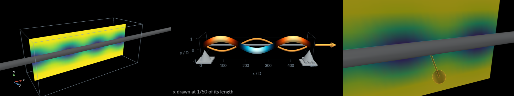

# Long bodies

The reference film's cylinder is 12 diameters long and fits in one frame with its wake.
A riser 500 diameters long does not. In a view of the whole span the body is two pixels
thick and its motion, about a diameter, cannot be seen. And one saved step may be too
large to load whole. This page gathers what FlowReel does about it (plan Section 5.6).

| Need | Answer |
|---|---|
| See the flow somewhere along the span | a **window**: `crop: {around: ...}` follows the body; only the window is read |
| Travel along the span | the window's `station` is a track, and the camera's `follow` takes it |
| See the shape of the whole span | the [`centreline`](layers-markers.md#centreline) layer, from the surface or the probes, with `amplify` |
| Fit the whole span in a frame | `stretch` draws the model compressed along one axis, and says so in the frame |
| Files too large to load | windowed reading of PLT files, and a memory check before rendering |
| Several stations at once | a [`stations`](layouts.md#one-shot-at-several-stations-stations) layout tiles one shot at several stations |
| Span against time, and where the window is | the [`map` and `locator`](panels.md#histories-along-a-long-body-map-and-locator) panels |

A runnable example on a generated case is `examples/long_span/run.py`: a channel 200
long whose floor is the body, read through a window that travels along it, and the
whole channel drawn at a tenth of its length.

## A window that travels: `crop: {around: ...}`

```yaml
crop:
  around: {body: riser, station: {from: 20, to: 480, frames: [0, 600]}}
  half: [10, 6, 15]                  # half-sizes along x, y, z, length unit
camera: {view: close, follow: true}  # follows the crop's station
```

| Key | Meaning | Default |
|---|---|---|
| `around.body` | the body the window follows | the one body |
| `around.station` | track, where along the body (length unit, along its axis) | required |
| `half` | three positive half-sizes of the box | required |

Each frame's box is centred on the body's centre at the station in that frame's step,
so it moves with a vibrating body. The camera's `follow` given no `station` takes the
crop's, and with `follow: true` its body too, so the window and the camera travel
together. The box of each frame is part of the frame's key. A `crop` box (`{x, y, z}`)
still works as before, and `outline: {bounds: crop}` draws whichever box the frame read.

## Reading only the window

The `flexflow` adapter reads a crop through a **window**. A PLT file stores each
variable as one block of every node's values, so the window's nodes of the asked
variables are read through a memory map, and nothing else leaves the disk. A body's
wall is read the same way: only its own nodes.

- **The span index.** A travelling window has a new box every frame. Choosing its cells
  by scanning the zone would cost a whole read each time, so FlowReel builds once per
  case a span index: the cells sorted by their least coordinate along the longest axis.
  A box's cells are then a binary search away. The index is kept outside the case, in
  `~/.cache/flowreel/windows/` (or `$XDG_CACHE_HOME`), keyed by the first step's file
  (path, size, modification time), so every render process reuses it and a rewritten
  file builds it again.
- **The window is chosen at the first step.** The connectivity does not change between
  steps, but the mesh moves with the body. Each step's cells are cut to the crop exactly
  as a whole read would cut them; `margin` grows the window so that cells the motion
  brings into the crop at a later step are in it.
- **The result is the same** as reading the zone whole and cutting it, as long as the
  margin covers the motion. `window: false` reads whole, to compare.

| Option of the `flexflow` source | Meaning | Default |
|---|---|---|
| `window` | read a crop through a window | `true` |
| `margin` | grow the window by this much on every side (length unit): at least the largest displacement | `0` |
| `cache` | folder of the span index; `null` keeps it in memory only | `~/.cache/flowreel/windows` |

```yaml
source: {adapter: flexflow, path: cases/riser500, margin: 2.0}
```

## `stretch`

```yaml
stretch: {x: 0.05}                   # the span drawn at 1/20 of its length
```

| Key | Meaning | Default |
|---|---|---|
| `x`, `y`, `z` | positive factors; at least one not 1 | `1` |
| `note` | `true` (the default text), `false`, or your own text | `true`: "x drawn at 1/20 of its length" |
| `corner` | `lower_left`, `lower_right`, `upper_left`, `upper_right` | `lower_left` |
| `size` | pixels (scaled in drafts) | `18` |
| `colour` | of the note | `#c8ccd0` |

The model is scaled after it is contoured and measured, so surfaces, stations and
supports are computed at true size and only the drawing is compressed. Named views are
in the drawn coordinates, as you see the stretched scene. `fit` and `follow`, which
start from model positions, use the drawn ones. The frame carries the note because a
stretched wake is not the wake's true shape. It is written in the bundled Lato.

Not everything is compressed. A support's symbol, the `axes` layer's arrows and ticks,
and a tension arrow keep their true shape and size where the stretched body puts them:
a pinned end drawn a fiftieth as long would no longer read as a pin. Labels (the axes'
numbers and names) go where the stretched model is drawn. A ruled box still gives true
lengths, so a span drawn at 1/50 reads 0 to 500 along its edge.

## The check: a riser 500 diameters long

Phase 2B ends on a case of the kind it was made for. No such run exists yet, so the
case is generated: `examples/riser500/riser500_case.py` writes, at test time or when
asked, eight steps of a channel 500 long round a riser of diameter 1 that vibrates in
its third mode, a second cylinder 12 long beside it, the riser's displacement at 51
probes (one CSV per probe, as FlexFlow Analyzer exports them) and a pendulum's swing.
The folder's `flowreel.yml` declares the riser pinned at 0 and on a roller under
tension at 500, the second cylinder clamped at both ends, and the pendulum hung from
the riser at mid-span. Nothing of it is checked in (about 45 MB).

Three shots read it:

- `travel.yml`: a window 20 long travels from station 20 to 480, the camera with it.
  Each step reads about 2500 of the 64 000 cells, 0.6 MB instead of 15.6.
- `span.yml`: the whole riser over the run from its probes, not the flow files: the
  centreline coloured by displacement, the rest line, the envelope, the supports, a
  ruled box in diameters, the span drawn at 1/50 of its length.
- `pendulum.yml`: the pendulum, a ghost because it is modelled and not meshed, swinging
  from the riser's centre at station 250 as its series says; a step reads 12 of the
  500.



**The window does not grow with the span.** The same window in a case half as long
costs the same, 0.61 MB, while reading the whole step costs half as much. A window's
cost is that of its own cells: what the travelling shot needs per job is the same for a
riser 500 or 5000 diameters long. `tests/test_riser500.py` checks that, and that the
frames render, the window reads a small part of the file and the pendulum follows its
series.

```bash
python examples/riser500/run.py riser500 --draft     # half size, first and last frames
python examples/riser500/run.py riser500             # every frame at full size
```

What the generated case cannot tell is how a real run's file compares: its node count,
its size and whether it saves the whole domain (plan Section 24, question 1). With the
first real file, `shot memory` on a windowed shot and the time the span index takes to
build once are the two numbers to look at.

## Memory

`memory_per_step` of a cropped flexflow source counts the window's nodes and cells, not
the domain's, and `shot memory` prints it beside the measured peak. Before drawing,
`shot render` estimates one job as 0.7 GB (Python, VTK and the reader) plus the data of
the frame that reads the most, sampling a few frames of a travelling window. It refuses
jobs that do not fit in 80% of the free memory, saying which `-j` would:

```text
Error: -j 16 needs about 35.2 GB (2.2 GB per job) and 25.0 GB is free to use: use -j 11 or fewer
```

A shot that cannot fit even one job is refused with the advice to crop it.
`--no-memory-check` (`check_memory=False`) draws anyway, for when you know better than
the estimate.
