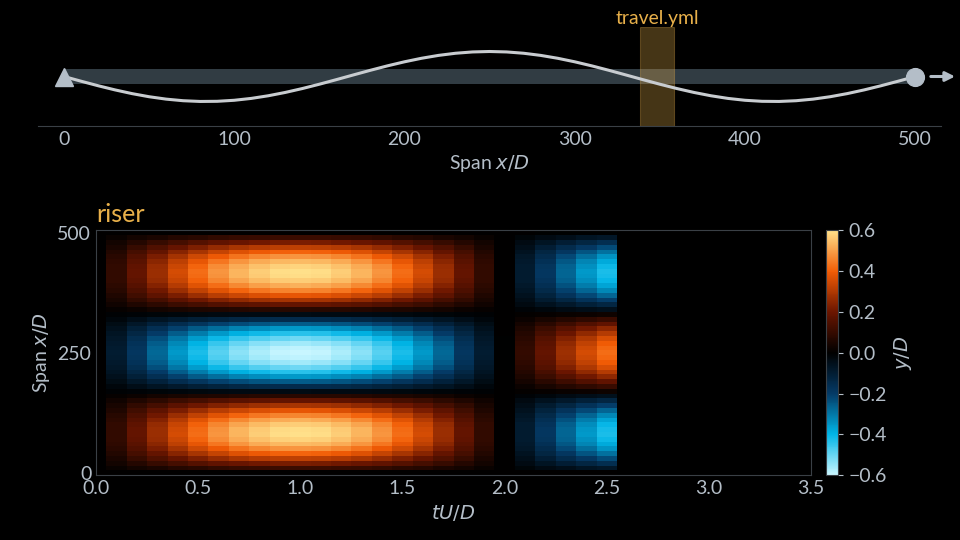

# Panels

A panel is a matplotlib figure drawn once per frame, at that frame's time: plots of
lift moving along with the film, a dot at the current value (plan Section 9.2). A
panel's frames go into a frame folder like a shot's, `OUT/<name>/frame_00000.png`, so a
[layout](layouts.md) tiles them beside the flow.

A runnable example on generated histories is `examples/panels/run.py`.

## A panel file

```yaml
type: series
size: [640, 1080]
times: {shot: shots/bare_wake.yml}
style: styles/film.yml
# ... the keys of the type
```

| Key | Type | Default | Meaning |
|---|---|---|---|
| `type` | `series`, `phase`, `map`, `locator` | required | the kind of panel |
| `name` | string | the file's name without `.yml` | the output folder |
| `size` | `[width, height]` | `[640, 360]` | pixels (the figure is drawn at 100 dots per inch) |
| `times` | list of numbers, or `{shot: FILE}` | required | the time of each frame |
| `style` | mapping, file, or `{from: FILE, ...}` | the defaults below | how it looks |

**Times.** Frame *i* is drawn at `times[i]`, in the source's time unit. With
`{shot: FILE}` the times are those of the shot's frames, the time of the step each
frame shows. A panel and a shot with the same times then line up frame by frame in a
layout. A list must not decrease. Branch 5 of Phase 3 adds panels drawn at the film's
output rate, between flow frames.

## Style

One style block is shared by every panel of a film, so all plots match. Put it in its
own file and name it from each panel: `style: styles/film.yml`. To change a few values
for one panel, write `style: {from: styles/film.yml, font_size: 20}`.

| Key | Type | Default | Meaning |
|---|---|---|---|
| `font` | string | `Lato` | text font family; the bundled Lato is always available |
| `font_size` | number | `17` | points; at 100 dots per inch a point is 1.39 pixels |
| `maths` | `dejavusans`, `dejavuserif`, `cm`, `stix`, `stixsans` | `dejavusans` | font for text between `$`, such as `'$C_L$'` |
| `background` | colour | `black` | the figure and the axes |
| `text` | colour | `'#b4bec8'` | labels and tick numbers |
| `grid` | colour | `'#3a4046'` | grid lines and the axes' edges |
| `line_width` | number | `2.2` | points |
| `grid_width` | number | `0.8` | points |
| `dot_size` | number | `8` | the current-time dot's diameter, points |
| `colours` | list of colours | five film colours | given in turn to lines that name none |
| `pad` | number | `0.12` | share of a data range added above and below, for ranges found from the data |

The defaults are the AFMS film's plots. Maths uses DejaVu Sans rather than Lato because
Lato has no maths glyphs; DejaVu Sans sits well beside it.

## Where the data comes from

Both panels read time histories declared for bodies in the project's `flowreel.yml`
(the nearest one at or above the panel file), under the body's `series`
([bodies](bodies.md)). A line names its series and, unless one body declares a series
of that name, its body:

| Key | Type | Default | Meaning |
|---|---|---|---|
| `series` | string | required | the series' name under the body |
| `body` | string | the one body with that series | the declared body |
| `column` | string | the series' only value column | the column, as renamed by `columns` |
| `scale`, `offset` | number | `1`, `0` | the value drawn is `value * scale + offset` |
| `label` | string | none | the line's name in the legend |
| `colour` | colour | the style's colours in turn | |

A series at many points (`by: node`) is not a line; the `map` and `locator` panels
draw those.

## `series`

```yaml
type: series
size: [640, 1080]
times: {shot: shots/bare_wake.yml}
x: {label: '$tU/D$', range: [0, 100]}
rows:
  - label: 'Mid-span $y/D$'
    lines:
      - {body: bare, series: motion, column: y, label: bare}
      - {body: helical, series: motion, column: y, label: helical}
  - label: '$C_L$'
    range: [-1.5, 1.5]
    lines:
      - {body: bare, series: force, column: cl}
      - {body: helical, series: force, column: cl}
margins: {left: 0.2, right: 0.95, top: 0.93, bottom: 0.08, space: 0.18}
```

Rows of axes, top to bottom, share one time axis. Each line runs from the start of its
series to the frame's time and ends there at a dot. Between two samples, the line's end
and the dot are at the value interpolated linearly between them. So a panel drawn at
times between the saved samples moves smoothly instead of jumping from sample to
sample. Before the first sample and after the last, the value is held.

| Key | Type | Default | Meaning |
|---|---|---|---|
| `x` | `{label, range}` | the panel's first to last time | the shared time axis |
| `rows` | list of `{label, range, lines}` | required (or `y` and `lines` for one row) | |
| `rows[].range` | `[low, high]` | from all its lines' values, padded by `pad` | |
| `legend` | bool | `true` | the first row's labelled lines, in their colours, above it |
| `margins` | `{left, right, top, bottom, space}` | `0.18, 0.95, 0.86, 0.16, 0.18` | axes' edges as shares of the figure; `space` between rows, as a share of a row's height |

A range found from the data covers the whole series, not only the part drawn so far,
so the axes do not move during the film. Line *j* of every row takes the style's colour
*j*, so a case keeps its colour from row to row.

## `phase`

```yaml
type: phase
size: [400, 400]
times: {shot: shots/pendulum.yml}
x: {body: riser, series: motion, column: y, label: '$y/D$'}
y: {body: pendulum, series: swing, column: angle, label: '$\theta$', range: [-0.5, 0.5]}
colour: '#d8707a'
```

One history against another: the trace up to the frame's time and a dot at the current
values. The trace takes a point at every sample time of either series before the
frame's time, each value interpolated, so two series sampled at different times still
pair up correctly.

| Key | Type | Default | Meaning |
|---|---|---|---|
| `x`, `y` | a line's keys (no `colour`) with `label` and `range` | required | the two histories and their axes |
| `colour` | colour | the style's first | |
| `margins` | `{left, right, top, bottom}` | as for `series` | |

## Histories along a long body: `map` and `locator`



These two read a history at many points along a body: a series declared with `by` (the
column that numbers the points) and `stations` (where each point is along the body),
such as the riser's probes ([bodies](bodies.md), [long bodies](long-bodies.md)). A
runnable example on the generated riser case is `examples/riser500/panels.py`, which
drew the picture above.

### `map`

```yaml
type: map
size: [1920, 1080]
times: [0, 0.05, 0.1]
x: {label: '$tU/D$'}
y: {label: 'Span $x/D$', ticks: [3, 6, 9]}
rows:
  - {body: bare, series: lift, column: cl, title: bare}
  - {body: helical, series: lift, column: cl, title: helical}
colormap: fire_ice
range: [-1.5, 1.5]
colorbar: {label: 'Sectional $C_L$'}
```

The history against time (across) and station (up), one cell per sample, coloured. At
each frame the samples up to that time are shown and the later ones are left out, so
the map fills in from the left. It moves from sample to sample; unlike the lines of a
`series` panel, it does not interpolate between them. Several bodies stack as rows on
one time axis, under one colour bar.

| Key | Type | Default | Meaning |
|---|---|---|---|
| `rows` | list | required | one per body: `body`, `series`, `column`, `scale`, `offset`, `title`, `colour` |
| `rows[].title` | string | none | over the row, on the left, in the row's `colour` |
| `rows[].colour` | colour | the style's colours in turn | the title's colour |
| `x` | `{label, range}` | the samples' first to last time | the time axis |
| `y` | `{label, range, ticks}` | the stations | the span axis; `ticks` a list of stations |
| `colormap` | string | `fire_ice` | `fire_ice` (black at the middle) or a matplotlib name |
| `range` | `[low, high]` | `[-a, a]`, `a` the largest magnitude | the colours' range |
| `colorbar` | `{label, fraction, pad}` or `false` | `{fraction: 0.025, pad: 0.02}` | matplotlib's colour bar settings |
| `title_size` | number | 1.3 times the style's `font_size` | points |
| `margins` | as for `series` | as for `series` | |

The default range is symmetric about zero, so a diverging map such as `fire_ice` has
its middle colour at zero: a sign change of lift reads as a change of hue. Without
declared `stations`, the point numbers stand in for them.

### `locator`

```yaml
type: locator
size: [1920, 200]
times: {shot: travel.yml}
body: riser
shape: {series: displacement, column: dy, amplify: 100}
windows: [{shot: travel.yml, label: window}]
x: {label: 'Span $x/D$'}
```

Where we are along a long body. The span is a grey bar from the first to the last
declared end. Over it are the body's shape at the frame's time, the supports, and the
window each named shot shows. A film that travels along a riser 500 diameters long
needs this to say where the window is.

| Key | Type | Default | Meaning |
|---|---|---|---|
| `body` | string | required | a declared body with an `axis` |
| `shape` | `{series, column, scale, offset, amplify, colour}` | none | the body's displacement history at many points |
| `shape.amplify` | number | `1` | the displacement is drawn this many times larger |
| `supports` | bool | `true` | the declared ends: pinned ▲, roller ●, clamped ■, spring ✕, prescribed ◆, free only with `mark`; `tension` adds an arrow |
| `windows` | list of `{shot, colour, label}` | none | shots whose crops are marked |
| `colour` | colour | the body's grey | the shape's line |
| `x` | `{label, range}` | the ends, plus 3% each side | |
| `y` | `{range}` | 1.4 times the largest amplified displacement | the displacement axis (no ticks) |
| `margins` | as for `series` | `left 0.04, right 0.98, top 0.85, bottom 0.3` | |

- **Shape.** At each frame, the value at each station is interpolated in time,
  then multiplied by `amplify`. A displacement of a diameter along 500 diameters
  cannot be seen otherwise. The y axis has no ticks because its numbers would be the
  amplified ones.
- **Windows.** Frame *i* marks the window of frame *i* of each shot: the crop's
  extent along the body's axis. A `crop: {around: ...}` travels with its station
  track; a crop box stays where it is. Frames are matched by index, as in a layout,
  because a frozen shot's frames all have one time. Past a shot's last frame, the
  window stays where the shot ends. The windows are worked out from the shot files
  alone; no flow data is read.
- The body needs declared `ends`, or a `shape` (its stations), or an `x` `range`, so
  that its span is known.

## Drawing: `compose.panel`

```python
from flowreel import compose

report = compose.panel("panels/lift.yml", "frames", jobs=4)   # frames/lift/frame_00000.png ...
print(report.count("drawn"), report.count("skipped"))
```

| Argument | Meaning |
|---|---|
| `pf` | a panel file or a loaded `PanelFile` |
| `out` | folder of frame folders (default `frames`) |
| `times` | draw at these times, not the panel's own |
| `frames` | only these frames |
| `jobs` | processes; each draws a run of consecutive frames |
| `force` | draw every frame again |

The figure is built once per process and only moved along in time. Building the axes,
reading the data and laying out the text cost far more than moving a few lines, and a
panel's frames differ only in time. So the frames are split into `jobs` runs of
consecutive frames, one process each.

**Keys.** Each frame has a key (plan Section 11): the panel's type, size and settings,
the style, the frame's time, and the path, size and modification time of each series
file the panel reads (and, for a locator, each window's shot file). A frame drawn
before with the same key is skipped. Moving one
time redraws one frame. Rewriting a series file, or changing the style, redraws them
all.
