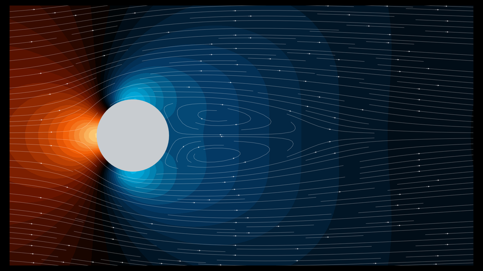

# 6. A panel: the pressure round the cylinder

A shot is drawn in 3D by VTK. A **panel** is a 2D figure drawn by matplotlib, one per
frame: a plot of a history with a dot moving along it, or, as here, a cut through the
flow drawn as filled contours ([panels](../panels.md)). Panels go into frame folders like
shots, so the film uses them the same way.

Make the folder `panels/` and write `panels/pressure.yml`:

```yaml
type: section
name: pressure
size: [1920, 1080]
times: {shot: ../shots/sweep.yml}     # one time per frame of that shot: 72 frames
body: cylinder
station: 0                            # where along the axis to cut: the middle of the span
field: p
range: [-1100, 1100]                  # the pressure here runs from about -720 to 1050
levels: 41
centre: [4.0, 0.0]
half: [3.2, 1.8]
streamlines: {relative: false}        # the cylinder does not move
```

- **`type: section`** cuts the flow across the body's axis, z, which you declared in
  chapter 2, at `station` 0 along it. It draws the field as filled contours, the
  streamlines, and the body.
- **`times`** gives the panel a frame for each frame of the sweep shot: 72 frames, 3 s.
  All show the one step; FlowReel draws it once and copies it.
- **`field: p`** is the pressure as the solver wrote it. FlowReel can also draw the
  pressure coefficient, `pressure_coefficient` with `params: {rho, u_inf}`, but this data
  set does not say what its density is, so the plain pressure is the honest choice.
- **`range`** must be given for a panel: a range taken from each frame would change from
  frame to frame ([rules](../rules.md)).
- **`centre` and `half`** fix the view: centred 1.5 diameters behind the cylinder, 3.2
  across and 1.8 up each way, so the wake is in the picture.
- **`streamlines: {relative: false}`**: streamlines are normally drawn as seen from a
  moving body. This one stands still, and the data has one step, so its motion cannot
  be measured anyway.

Draw it:

```text
$ flowreel compose panel panels/pressure.yml
```

The frames go to `frames/pressure/`.



High pressure (orange) where the flow meets the cylinder, low pressure (blue) over its
top and bottom where the flow is fastest. Behind the cylinder, two closed streamlines
show the two vortices that stay attached at this Reynolds number: the flow turns back
on itself there and never leaves.

Next: [the film file](07-film.md).
