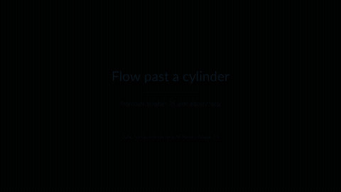

# Tutorial: a 20-second film

In this tutorial you make a short film of the flow past a cylinder, from a public data
set, with nothing but FlowReel's commands and a few YAML files. It takes about an hour,
most of it reading. The computer's part takes a few minutes.

The film has five shots:

1. **A title card** (3 s).
2. **The wake** (7 s): the flow coloured by its vorticity, with the camera moving in from
   the whole domain to the cylinder. A caption with mathematics, then a freeze with a
   caption pinned to the cylinder.
3. **A sweep** (3 s): the same flow, its colour range narrowed to show the weak
   vorticity far from the wall.
4. **The pressure** (3 s): a panel of the pressure round the cylinder, with streamlines.
5. **The end** (4 s): the last picture held, fading out.

It is silent; [the film file](../film.md#audio) says how to add sound.

## Chapters

Each chapter ends with a picture to compare with yours.

1. [Install](01-install.md): FlowReel and ffmpeg in a conda environment.
2. [The project and the data](02-project.md): a project folder, the data, the body.
3. [A first shot](03-first-shot.md): a shot file, coloured by vorticity, and a preview.
4. [The camera](04-camera.md): a camera move picked in the camera editor.
5. [A second shot](05-sweep.md): a colour range that sweeps.
6. [A panel](06-panel.md): the pressure round the cylinder.
7. [The film file](07-film.md): a card, captions, a freeze; `film check`.
8. [Building the film](08-build.md): the frames at full size, a preview, the film; on a
   cluster.

Every file the tutorial writes is in `examples/tutorial/project/` as it stands at the
end, so you can compare yours with it. After it, [the second tutorial](unsteady/index.md)
films a flow that moves.

## What you need

- Linux or macOS, with conda (Miniconda or Miniforge).
- A few GB of disk for the environment (VTK and its friends are large), and about
  100 MB for the project.
- An internet connection to download the data, 0.7 MB. Without one,
  [a generated stand-in](data.md#getting-it) works for every step.
- A display for chapter 4 only. On a cluster or over `ssh`, that chapter says what to do
  instead.

You do not need to know Python. You will edit YAML files: plain text, with `key: value`
lines and indentation for nesting. Indent with spaces, never tabs.
