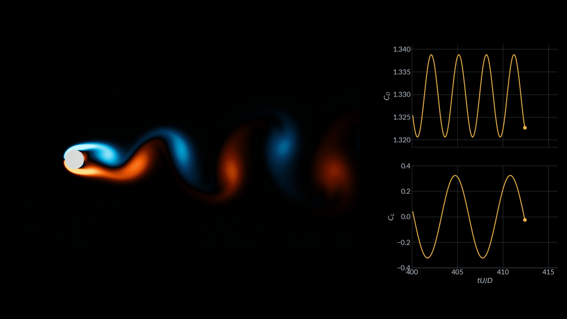

# 3. The force beside it

## A panel of the force

Make the folder `panels/` and write `panels/force.yml`:

```yaml
type: series
size: [640, 1080]
times: {shot: ../shots/wake.yml}      # the time of each of the shot's frames
x: {label: '$tU/D$'}
rows:
  - label: '$C_D$'
    lines: [{body: cylinder, series: force, column: fx, scale: 2}]   # C = F / (rho U^2 D / 2)
  - label: '$C_L$'
    lines: [{body: cylinder, series: force, column: fy, scale: 2}]
legend: false
```

A `series` panel draws a body's time histories, one row of axes each, on one time
axis ([panels](../../panels.md#series)). Each line runs from the start of the series up
to the frame's time and ends at a dot, so the force is drawn as the flow beside it
moves.

- **`times: {shot: ...}`** gives the panel one frame for each of the shot's frames,
  at the time of the step that frame shows. When the shot slows down, so does the dot.
- **`lines`** name the body and the series declared in `flowreel.yml`, and its
  column. `scale: 2` turns the force into a coefficient: `C = F / (rho U^2 D / 2)`,
  and the record's density, speed and diameter are all 1.

```text
$ flowreel compose panel panels/force.yml
```

## Side by side

The panel goes beside the shot in a **layout**, which tiles folders of frames into one
picture a frame ([layouts](../../layouts.md)). Write `layouts/board.yml`:

```yaml
size: [1920, 1080]
background: black
tiles:
  - {frames: ../frames/wake, at: [0, 180], size: [1280, 720]}
  - {frames: ../frames/force, at: [1280, 0], size: [640, 1080]}
```

Folders in a layout are taken from the layout file's own folder, so the frames are
`../frames/...`. The shot is rendered at its tile's size, `[1280, 720]`, so it is not
resized. Render the shot at full size, then compose:

```text
$ flowreel shot render shots/wake.yml -j 4
$ flowreel compose layout layouts/board.yml
```



The lift swings once each time a vortex leaves, and the drag twice, once for each side:
the drag's dot runs through two crests while the lift's runs through one.

Next: [the film](04-film.md).
