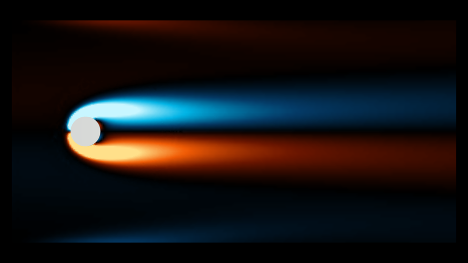

# 3. A first shot

A **shot** is a YAML file that says what to draw: the data (the source), which time
steps, the camera, the picture's size, and a list of **layers** drawn one over another.
FlowReel renders it to a folder of frames, `frame_00000.png`, `frame_00001.png` and so
on.

## Start from a template

```text
$ flowreel shot template wake --layers slice,body -o shots/wake.yml
```

The template has every key of a shot and of the layers you named, each at its default,
with a comment. Read it once: it is the reference for what a shot can say. Then cut it
down to this:

```yaml
name: wake
source:
  adapter: vtk
  path: ../data/cylinder_crossflow/flow.pvd
  body: {cylinder: ../data/cylinder_crossflow/cylinder.vtp}
time: {frozen: 0, frames: 120}        # one saved step, shown for 120 frames (5 s at 24)
camera: {view: main}                  # the view project init wrote in cameras.yml
size: [1920, 1080]
layers:
  - type: slice                       # the plane z = 0, through the middle of the span
    normal: z
    position: 0.0
    field: vorticity_z                # computed from the velocity (docs/guide/projects/fields.md)
    range: [-60, 60]
  - type: body
    body: cylinder
    colour: '#c8ccd0'
```

What each part means:

- **`source`** is the data, as in `project init`, written out in full so it can name the
  body. Paths in a file are relative to that file, here `shots/` ([rules](../../guide/projects/rules.md)),
  so the data is `../data/...`.
- **`time: {frozen: 0, frames: 120}`** shows step 0 for 120 frames. This data set has
  one step: the flow is steady. A frozen shot is cheap, because the flow is read and cut
  once and reused for every frame. The camera can still move, as it will in the next
  chapter.
- **The `slice` layer** is the plane z = 0, through the middle of the slab, coloured by
  `vorticity_z`: how fast the fluid spins about the z axis. FlowReel computes it from
  the velocity. It never uses a solver's stored vorticity ([fields](../../guide/projects/fields.md)).
  `range` is the value at each end of the colour map. With the default map, `fire_ice`,
  zero is black, negative values are blue and positive ones orange. Positive is
  anticlockwise.
- **The `body` layer** draws the cylinder, by the name `flowreel.yml` gave it.

## Preview it

```text
$ flowreel shot preview shots/wake.yml
```

A preview draws every tenth frame and the last, at a quarter of the size, into
`frames/wake@480x270/`, at the project root. Draft frames never mix with the full-size
ones. Open them in any image viewer.



Blue above the cylinder, orange below: the fluid passing over the top is turned
clockwise by the wall, and the fluid passing underneath anticlockwise. The two layers of
vorticity trail behind it in the wake.

**Try** another field: `speed` with `range: [0, 50]` and `colormap: viridis`, or `p`
(the pressure) with `range: [-1100, 1100]`. Preview after each change: frames whose
picture would not change are not drawn again. Put the vorticity back before going on.

Next: [the camera](04-camera.md).
