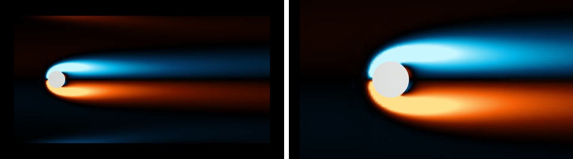

# 4. The camera

A camera **view** is a position, a point looked at (the focal point), an up direction and
an angle of view. A **track** moves the camera from view to view over a shot's frames.
Both live in the project's one `cameras.yml`, at its root ([cameras](../../cameras.md)).
You could type the numbers, but it is easier to pick views by eye in the **camera
editor**.

## Pick the views

```text
$ flowreel camera edit shots/wake.yml --track approach
```

A window opens on the shot's scene, seen from the view `main`.

1. **The start.** `main` shows the whole domain, edge to edge. Zoom out a little with
   the mouse wheel, so it has a margin. Leave the **Frame** slider at 0 and press `s`:
   the view is saved as the track's key at frame 0.
2. **The end.** Move the Frame slider to 96. Zoom in on the cylinder, and pan with a
   middle drag (or shift and left drag) until the cylinder sits a little left of
   centre, with the wake behind it. Press `s`.
3. **Watch.** Press `p`: the camera moves from the first view to the second, as the
   shot will. Not right? Press `u` to undo, or move the Frame slider near a key and
   press `r` to replace that key with the camera's view.
4. **Close the window.** There is nothing to save: every change was written at once.

Keep the camera looking straight down the z axis: a left drag turns it, and a 2D flow
seen at a slant shows its thin slab. If it turns, close the window without pressing `s`
and open it again.

`cameras.yml` now has the track:

```yaml
views:
  - {name: main, position: [7.5, 0, 16.58431881165276], focal: [7.5, 0, 0], up: [0, 1, 0], view_angle: 30}
  - {name: approach_0000, position: [7.5, 0, 17.5], focal: [7.5, 0, 0], up: [0, 1, 0], view_angle: 30}
  - {name: approach_0096, position: [3.6, 0, 8.2], focal: [3.6, 0, 0], up: [0, 1, 0], view_angle: 30}
tracks:
  approach:
    frames: 120
    path: linear
    ease: smooth
    keys:
      - {frame: 0, view: approach_0000}
      - {frame: 96, view: approach_0096}
```

Your numbers will differ: they are where you put the camera. The keys' views are named
after the track and their frame. `ease: smooth` starts and stops the move gently. After
frame 96, the last key's view holds to the end of the shot.

**No display?** On a cluster or over `ssh` the editor cannot open a window. Either run
it on a machine with a display (`flowreel shot render shots/wake.yml --frames 0
--save-vtp vtp` saves the scene to open there with `camera edit --vtp vtp`; see
[the camera editor](../../camera-editor.md)), or copy the views and the track above into
your `cameras.yml`.

## Use the track

In `shots/wake.yml`, replace the camera line:

```yaml
camera: {track: approach}             # picked in the camera editor: cameras.yml
```

and preview again:

```text
$ flowreel shot preview shots/wake.yml --every 24
```



Next: [a second shot](05-sweep.md).
