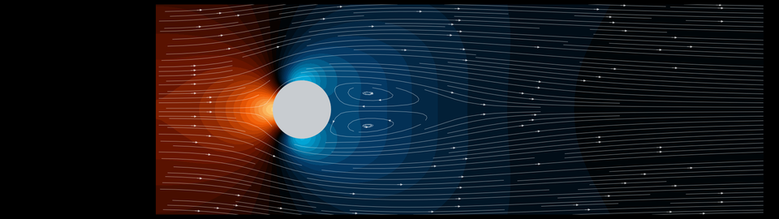

# 6. A panel: the pressure round the cylinder

A shot is drawn in 3D by VTK. A **panel** is a 2D figure drawn by matplotlib, one per
frame: a plot of a history with a dot moving along it, or, as here, a cut through the
flow drawn as filled contours ([panels](../../guide/shots/panels.md)). In the film a
panel is a box of a scene, drawn by the build at the box's size; on its own, `panel draw`
draws its frames to look at.

Make the folder `panels/` and write `panels/pressure.yml`:

```yaml
type: section
name: pressure
size: [1920, 540]                     # a strip: the film shows it in half the frame
times: {shot: ../shots/sweep.yml}     # one time per frame of that shot: 72 frames
body: cylinder
station: 0                            # where along the axis to cut: the middle of the span
field: p
range: [-1100, 1100]                  # the pressure here runs from about -720 to 1050
levels: 41
centre: [4.0, 0.0]
half: [6.4, 1.8]
streamlines: {relative: false}        # the cylinder does not move
```

- **`type: section`** cuts the flow across the body's axis, z, which you declared in
  chapter 2, at `station` 0 along it. It draws the field as filled contours, the
  streamlines, and the body.
- **`times`** gives the panel a frame for each frame of the sweep shot: 72 frames, 3 s.
  All show the one step; FlowReel draws it once and copies it.
- **`field: p`** is the pressure as the solver wrote it. With the tag's units (chapter 2)
  FlowReel can also draw the pressure coefficient, `pressure_coefficient`, with no
  `params`: it takes `rho` and `u_inf` from the tag.
- **`range`** must be given for a panel: a range taken from each frame would change from
  frame to frame ([rules](../../guide/projects/rules.md)).
- **`size` and `half`**: a strip twice as wide as a film's half-height, since the film
  will show it in the lower half of the frame. `centre` and `half` fix the view:
  centred 4 diameters behind the cylinder, 6.4 across and 1.8 up each way, so the wake
  is in the picture.
- **`streamlines: {relative: false}`**: streamlines are normally drawn as seen from a
  moving body. This one stands still, and the data has one step, so its motion cannot
  be measured anyway.

Draw it:

```text
$ flowreel panel draw panels/pressure.yml
```

The frames go to `frames/pressure/`.



High pressure (orange) where the flow meets the cylinder, low pressure (blue) over its
top and bottom where the flow is fastest. Behind the cylinder, two closed streamlines
show the two vortices that stay attached at this Reynolds number: the flow turns back
on itself there and never leaves.

**Try** the pressure in the shot as well: lines of equal pressure over the sweep's
vorticity, with a [`contour`](../../guide/shots/layers-flow.md#contour) layer on the same plane. Add it
to the end of `shots/sweep.yml`'s layers, after the slice:

```yaml
  - {type: contour, normal: z, position: 0.0, field: pressure, levels: 15, range: [-700, 700],
     colour: '#ffffff', width: 1.5, opacity: 0.7}
```

and preview the sweep again. The lines crowd in front of the cylinder, where the
pressure rises fastest, and open out in the wake. Keep them or take them out: the rest
of the tutorial works either way.

Next: [a scene of one box](07-scene.md).
