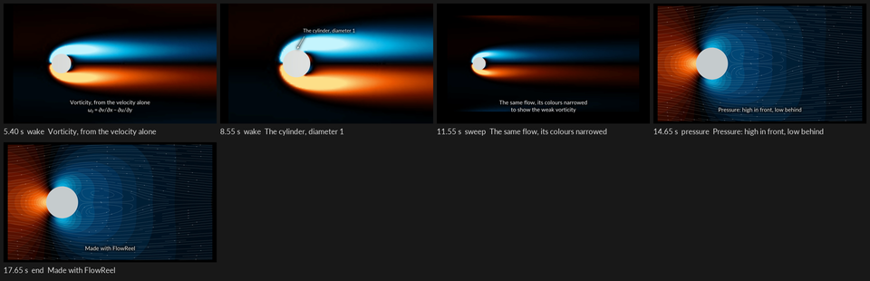

# 7. The film file

`film.yml` puts the shots in order and says what goes on them: cards, captions,
freezes, fades and sound ([the film file](../../guide/film/film.md)). `project init` wrote a starting
one with every key and a comment. This chapter replaces it with the tutorial's film.

Times in `film.yml` are **seconds of film**. A shot's own frames are counted in frames,
but the film plays at `fps` frames a second, so 120 frames at 24 a second last 5 s.

## A title card

A card is a still picture of text, drawn by FlowReel ([cards](../../guide/film/cards.md)). Write
`cards/title.yml`:

```yaml
blocks:
  - {title: ['Flow past a cylinder'], size: 76, y: 380}
  - {divider: 320, gap: 40}
  - {text: ['Reynolds number 35, one steady step'], size: 34, gap: 40}
  - {text: ['Data: PyVista example data (M. Flamm), Apache-2.0'], size: 24, gap: 150}
```

Blocks are drawn top to bottom, each centred across the card: `y` places a block's top
in pixels from the card's top, and `gap` places it below the block before it. The last
line credits the data, as its licence asks.

## Captions

Captions can be written in `film.yml` or kept in files of their own, in `text/`, so the
words can be edited without touching the film. Write `text/wake.yml`:

```yaml
- lines: ['Vorticity, from the velocity alone', '$\omega_z = \partial v / \partial x - \partial u / \partial y$']
  at: [0.6, 4.2]
  place: bottom
```

Text between `$` signs is **mathematics**, written as in LaTeX. Keep such lines in
single quotes, so YAML leaves the backslashes alone. `at` is when the caption shows, in
seconds from the start of the shot; it fades in and out.

And `text/freeze.yml`, the caption of the freeze:

```yaml
- lines: ['The cylinder, diameter 1']
  place: {model: [2.5, 0.5, 0.05], offset: [60, -190]}
  size: 44
  align: left
  shapes:
    - {arrow: {from: {model: [2.5, 0.5, 0.05], offset: [70, -120]},
               to: {model: [2.5, 0.5, 0.05], offset: [8, -10]}, width: 4}}
```

`{model: [x, y, z]}` is a **point in the model**: the top of the cylinder, in the data's
own units. FlowReel finds where that point is in each frame from the camera that drew
it, so the caption and its arrow stay on the cylinder while the camera moves
([points in the model](../../guide/film/captions.md#points-in-the-model)). `offset` moves them from
that point by pixels: right, and up (negative is up).

## The film

Replace `film.yml` with:

```yaml
output: film.mp4
fps: 24
size: [1920, 1080]
# no audio: the film is silent (docs/guide/film/film.md#audio adds a track)
shots:
  - {name: title, card: cards/title.yml, seconds: 3, fade: [0.5, 0.5]}
  - name: wake                        # 120 frames at 24 a second: 5 s, and a 2 s freeze
    frames: frames/wake
    fade: [0.5, 0]
    text: text/wake.yml
    freezes: [{at: 4.5, hold: 2, text: text/freeze.yml}]
  - name: sweep                       # 72 frames: 3 s
    frames: frames/sweep
    text: [{lines: ['The same flow, its colours narrowed', 'to show the weak vorticity'], at: [0.3, 2.8]}]
  - name: pressure                    # the panel's 72 frames: 3 s
    frames: frames/pressure
    text: [{lines: ['Pressure: high in front, low behind'], at: [0.3, 3]}]
  - name: end
    hold_last_of: pressure
    seconds: 4
    fade: [0, 1.5]
    text: [{lines: ['Made with FlowReel'], at: [0.3, 3], place: bottom}]
```

- **Kinds of shot.** `card` shows a card for `seconds`. `frames` plays a folder of
  frames, here those `shot render` and `compose panel` write. `hold_last_of` holds the
  last frame of another shot.
- **`fade: [in, out]`** fades from and to black, in seconds.
- **The freeze** stops the wake at 4.5 s, on the close view, and holds that frame for
  2 s with its caption. What follows it moves on by 2 s, so the wake lasts 7 s.
- **Silence.** Without `audio`, the film has no sound track to play.
- **Quote a caption line with a colon** in it, as `'Pressure: high in front, ...'`:
  unquoted, YAML would read it as a key and a value.

In all: 3 + 7 + 3 + 3 + 4 = 20 seconds.

## Check it

The film plays frames from `frames/wake`, `frames/sweep` and `frames/pressure`, at full
size. The previews of chapters 3 to 5 were drafts, so render the shots now. This is the
slow part: a few minutes per shot on a laptop, less with more cores (`-j`):

```text
$ flowreel shot render shots/wake.yml -j 4
$ flowreel shot render shots/sweep.yml -j 4
```

(`compose panel` in chapter 6 already drew the panel's frames at full size.) Then:

```text
$ flowreel film check
```

`film check` draws a **contact sheet**, `contact.png`: a still from the middle of every
caption, labelled with its time and shot. The stills come from the shots' finished
clips, with their text, so it builds the clip of each shot that has a caption. Read it as a check of the words and their places before the film is joined.



If a caption pinned to the model were hidden (behind the camera, or off the picture),
`film check` would say so here, with its shot and times.

Next: [building the film](08-build.md).
