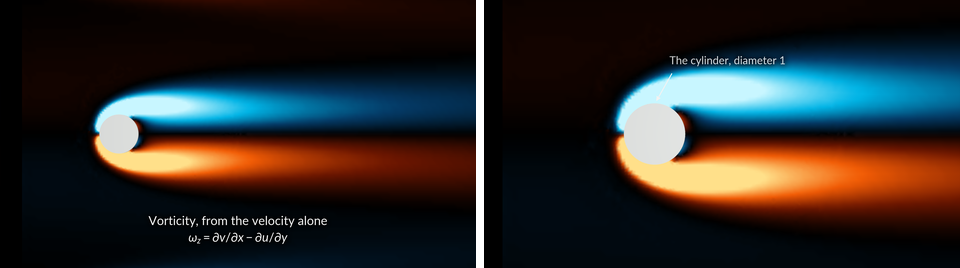

# 7. A scene of one box

A film is a list of **scenes**. A scene shows a **layout**: boxes placed on the frame,
each showing one thing (text, a picture, a shape, a shot, a panel). The simplest scene
is one shot filling the frame; captions are text boxes laid over it
([the film](../../guide/film/film.md), [layouts and boxes](../../guide/film/layouts.md)).

## The film file and its first scene

`project init` wrote a starting `film.yml` of an older kind. Replace it with this:

```yaml
output: film.mp4
fps: 24
size: [1920, 1080]
style:
  looks:
    text: {valign: bottom, margin: 80}    # captions sit low in their box, as captions do
scenes:
  - name: wake                            # the shot's 120 frames: 5 s, and a 2 s freeze
    fade: [0.5, 0]
    chapter: The wake
    layout:
      boxes:
        - name: main
          shot: {file: shots/wake.yml, freezes: [{at: 4.5, hold: 2}]}
        - text: ['Vorticity, from the velocity alone', '$\omega_z = \partial v / \partial x - \partial u / \partial y$']
          at: [0.6, 4.2]
        - text: {lines: ['The cylinder, diameter 1'], size: 44, align: left}
          follow: {box: main, model: [2.5, 0.5, 0.05], offset: [60, -190]}
          at: [4.8, 6.3]                  # in the freeze, which runs from 4.5 to 6.5
        - shape: {kind: arrow, direction: down_left}   # down to the cylinder's top
          follow: {box: main, model: [2.5, 0.5, 0.05], offset: [8, -10]}
          size: [63, 111]
          at: [4.8, 6.3]
```

`flowreel film template` prints a film file with every key and its default, to
read once. What this one says:

- **The film's properties**: its file, 24 frames a second, 1920 by 1080, and a `style`.
  Each text box starts from a **look** (`title`, `text` or `small`); here the `text` look
  puts the words at the foot of their box, 80 pixels up.
- **The scene** `wake` has a **layout** of four boxes, drawn in order, the first at the
  back. A scene with a shot lasts as long as the shot plays: 120 frames at 24 a second
  is 5 s, and the **freeze** holds the frame at 4.5 s for 2 s, so 7 s. It fades in from
  black over half a second, and starts a chapter.
- **The shot box** `main` has no place, so it fills the frame. The shot is drawn at the
  size of its box: 1920 by 1080.
- **The caption** is a text box with a time, `at: [0.6, 4.2]`: seconds into the scene. It
  fades in and out over 0.8 s, the look's fade. It fills the frame too, so the look puts
  it at the bottom. `$...$` is mathematics.
- **The label and the arrow** `follow` a point of the flow: the top of the cylinder,
  `[2.5, 0.5, 0.05]` in the data's units. On every frame FlowReel finds where the camera
  that drew the shot put that point, so the label stays on the cylinder while the camera
  moves. The label's upper left corner goes `offset` pixels from it. The arrow is drawn
  across its box, 63 by 111 pixels, from its upper right corner `down_left` to the
  lower left, where its tip is, at its own offset from the point.

Scenes are written in the film file, or in a layout file of their own (the next
chapter). Every key is checked as the file is read: a misspelt key stops with the file
and the key's place ([rules](../../guide/projects/rules.md)).

## Render the shot, look at the scene

The film is built from frames rendered beforehand, so render the shot, now at the size
of its box:

```text
$ flowreel shot render shots/wake.yml -j 4
...
120 rendered, 0 skipped in 41.3 s -> /home/you/films/cylinder/frames/wake (backend egl)
```

Then look at the scene before encoding anything:

```text
$ flowreel scene list
scene    start   length  boxes
wake    0.00 s    7.00 s  main (shot, main), text2 (text), text3 (text), shape4 (shape); chapter 'The wake'
film    7.00 s
$ flowreel scene preview wake --at 2 5.5
  at_2.00.png
  at_5.50.png
2 stills of wake in 1.9 s -> /home/you/films/cylinder/frames/scenes/wake
```

`scene preview` draws stills of a scene as the build will draw its frames, into
`frames/scenes/wake/`. At 2 s the caption is in; at 5.5 s the frame is held and the
label points at the cylinder.



**Try** moving the label: change its `offset` and preview again. Change the caption's
`at`, or give it `box: true` for a dark box behind it in place of the shadow
([boxes](../../guide/film/boxes.md#text)).

Next: [a layout of several boxes](08-layout.md).
