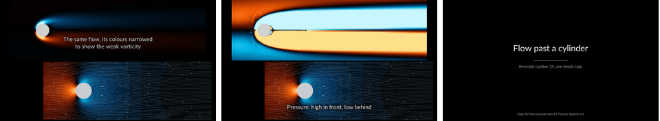

# 8. A layout of several boxes

A scene's boxes can share the frame: two pictures side by side, a plot under a shot, a
title with a line under it. When a layout is used by more than one scene, or is long, it
goes in a file of its own under `layouts/`, and the scene names it
([layouts and boxes](../../guide/film/layouts.md)).

## Vorticity and pressure

Make the folder `layouts/` and write `layouts/compare.yml`:

```yaml
boxes:
  - name: main                        # sets the scene's length: 72 frames, and a 3 s hold
    shot: {file: ../shots/sweep.yml, freezes: [{at: 3, hold: 3}]}
    place: top
  - panel: ../panels/pressure.yml     # drawn by the build at this box's size
    place: bottom
  - text: ['The same flow, its colours narrowed', 'to show the weak vorticity']
    place: top
    at: [0.3, 2.8]
  - text: ['Pressure: high in front, low behind']
    place: bottom
    at: [3.2, 5.8]
```

- **`place`** puts a box in half the frame (`top`, `bottom`, `left`, `right`), its middle
  (`centre`) or a quarter (`top_left` ...). A place is a share of the frame, so the layout
  fits a film of any size. `pos: [x, y]` and `size: [w, h]` in pixels place a box
  exactly, where that is needed.
- **The shot box** `main` sets the scene's length: the sweep's 72 frames, 3 s, then held
  for 3 s by a freeze at its end. The sweep is drawn at the size of its box, 1920 by 540.
- **The panel box** is drawn by the build at its box's size, on every frame: the panel's
  frames play from the scene's start, and hold their last when they end.
- **Paths** in a layout file are taken from its folder, `layouts/`, so the shot is
  `../shots/sweep.yml` ([rules](../../guide/projects/rules.md)).

Add the scene to `film.yml`, after `wake`:

```yaml
  - name: compare                         # 6 s: the sweep's 3 s, then held for 3
    chapter: Vorticity and pressure
    layout: compare                       # layouts/compare.yml
```

## A title

A scene without a shot is text and pictures, and says how long it lasts. Write
`layouts/title.yml`:

```yaml
boxes:
  - text: {lines: ['Flow past a cylinder'], look: title, size: 76, valign: bottom}
    place: top                        # the upper half, the title at its foot
  - shape: {kind: line, width: 2, colour: '#96a5b2'}
    pos: [810, 538]                   # a divider at the middle, in the film's pixels
    size: [300, 3]
  - text: {lines: ['Reynolds number 35, one steady step'], look: small, size: 34, valign: top}
    place: bottom                     # the lower half, at its head
  - text: {lines: ['Data: PyVista example data (M. Flamm), Apache-2.0'], look: small, valign: bottom}
    place: bottom                     # and at its foot
```

and put it first in `film.yml`'s scenes:

```yaml
  - name: title
    seconds: 3
    fade: [0.5, 0.5]
    chapter: Opening
    layout: title                         # layouts/title.yml
```

The `title` look is large and without a shadow; `small` is small and in the quieter
colour. A `line` shape is drawn across its box, here 300 pixels wide and 3 high.

## Look at them

```text
$ flowreel shot render shots/sweep.yml -j 4
$ flowreel scene preview compare --at 1 4.5
$ flowreel scene preview title --at 2
```



**With a display**, open the layout in the design window:

```text
$ flowreel scene design compare
```

The scene is drawn as the build draws it, at the moment of the *Time* slider. Drag a box
to move it, a corner to resize it, or drag on empty space to draw a new one; edges snap
to each other and to a grid. The panel on the right names the selected box and fills it.
Every change is checked and written to `layouts/compare.yml` at once, so close the
window when you are done ([designing a layout](../../guide/film/layouts.md#designing-a-layout-scene-design)).
Put the file back as above before going on, or keep your changes: the rest works either
way. Without a display, skip it.

Next: [the film](09-film.md).
