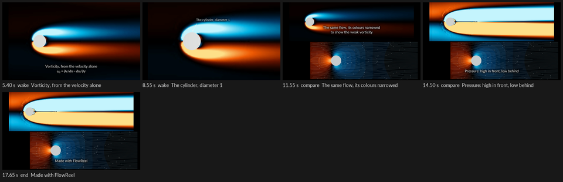

# 9. The film

## The last scene

The film ends on the last picture of `compare`, held, with a word, fading out. Add it to
the end of `film.yml`'s scenes. The whole file is now:

```yaml
# The tutorial's film: four scenes, 20 seconds, silent. Reference: docs/guide/film/film.md.
output: film.mp4
fps: 24
size: [1920, 1080]
style:
  looks:
    text: {valign: bottom, margin: 80}    # captions sit low in their box, as captions do
# no audio: the film is silent (docs/guide/film/film.md#audio adds a track)
scenes:
  - name: title
    seconds: 3
    fade: [0.5, 0.5]
    chapter: Opening
    layout: title                         # layouts/title.yml
  - name: wake                            # the shot's 120 frames: 5 s, and a 2 s freeze
    fade: [0.5, 0]
    chapter: The wake
    layout:
      boxes:
        - name: main
          shot: {file: shots/wake.yml, freezes: [{at: 4.5, hold: 2}]}
        - text: ['Vorticity, from the velocity alone', '$\omega_z = \partial v / \partial x - \partial u / \partial y$']
          at: [0.6, 4.2]
        - text: {lines: ['The cylinder, diameter 1'], size: 44, align: left}
          follow: {box: main, model: [2.5, 0.5, 0.05], offset: [60, -190]}
          at: [4.8, 6.3]                  # in the freeze, which runs from 4.5 to 6.5
        - shape: {kind: arrow, direction: down_left}   # down to the cylinder's top
          follow: {box: main, model: [2.5, 0.5, 0.05], offset: [8, -10]}
          size: [63, 111]
          at: [4.8, 6.3]
  - name: compare                         # 6 s: the sweep's 3 s, then held for 3
    chapter: Vorticity and pressure
    layout: compare                       # layouts/compare.yml
  - name: end
    seconds: 4
    fade: [0, 1.5]
    layout:
      boxes:
        - last_frame: compare
        - text: ['Made with FlowReel']
          at: [0.3, 3]
```

A `last_frame` box holds the last frame of another scene. The scenes last 3 + 7 + 6 + 4:
20 seconds.

## Check it

```text
$ flowreel scene list
$ flowreel film check
wrote contact.png in 6.8 s
```

`film check` builds each scene's clip and lays stills of them on one picture,
`contact.png`: one at the middle of every caption, labelled with its time and scene, to
read the words without playing the film ([checking the film](../../guide/making/check.md)).



## Build it

```text
$ flowreel film build --preview 480
scene    planned  measured
title      3.00 s    3.00 s  built
wake       7.00 s    7.00 s  kept
compare    6.00 s    6.00 s  kept
end        4.00 s    4.00 s  kept
film      20.00 s   20.00 s  film.mp4
preview film_480p.mp4
srt film.srt
chapters chapters.txt
chapters shorter than YouTube's 10 s: Opening, The wake
built in 3.1 s
```

The clips `film check` made for its stills are kept (each has a key of everything in it);
the build makes the title's, which has no caption to take a still at, and joins them. Beside `film.yml` are now:

- **`film.mp4`**, the film, and **`film_480p.mp4`**, a small copy to send.
- **`film.srt`**, the captions as subtitles: every text box with a time.
- **`chapters.txt`**, the chapters as YouTube reads them from a description. The note
  says YouTube would not show these: its chapters last at least 10 s each.

Change a caption and build again: only its scene's clip is made again
([building the film](../../guide/making/build.md)).

## On a cluster

Rendering is the slow part, and a cluster does it well. On a Slurm cluster,

```text
$ flowreel shot render shots/wake.yml --submit
$ flowreel shot render shots/sweep.yml --submit
$ flowreel film build --submit --after JOB1 --after JOB2 --preview 480
```

renders both shots as jobs and builds the film when they end
([rendering on Slurm](../../guide/making/slurm.md)). The second tutorial does this with a
flow that moves.

That is the whole film. Next: [the second tutorial](../unsteady/index.md), a flow that
moves.
