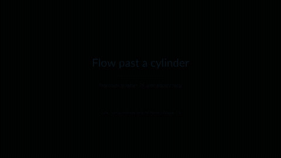

# Tutorial: a 20-second film

In this tutorial you make a short film of the flow past a cylinder, from a public data
set, with nothing but FlowReel's commands and a few YAML files. It takes about an hour,
most of it reading. The computer's part takes a few minutes.

A film is described in **levels**, and the chapters climb them: the project and its
data; a shot; a scene of one box; a layout of several boxes; the film. The film has four
scenes:

1. **The title** (3 s): text and a line.
2. **The wake** (7 s): the flow coloured by its vorticity, the camera moving in from the
   whole domain to the cylinder. A caption with mathematics, then a freeze with a label
   and an arrow pinned to the cylinder.
3. **Vorticity and pressure** (6 s): the same flow above, its colour range narrowed to
   show the weak vorticity far from the wall, and the pressure round the cylinder below.
4. **The end** (4 s): the last picture held, fading out.

It is silent; [the film's audio](../../guide/film/film.md#audio) says how to add sound.

## Chapters

Each chapter ends with a picture to compare with yours.

1. [Install](01-install.md): FlowReel and ffmpeg in a conda environment.
2. [The project and its data](02-project.md): a project folder, the data brought in as a
   tag, its units and its body.
3. [A first shot](03-first-shot.md): a shot file, coloured by vorticity, and a preview.
4. [The camera](04-camera.md): a camera move picked in the camera editor.
5. [A second shot](05-sweep.md): a colour range that sweeps.
6. [A panel](06-panel.md): the pressure round the cylinder.
7. [A scene of one box](07-scene.md): the film file, its first scene, a caption, a freeze
   and a label pinned to the cylinder.
8. [A layout of several boxes](08-layout.md): two pictures in one scene, and a title.
9. [The film](09-film.md): every scene, checked, built, with a preview; on a cluster.

Every file the tutorial writes is in `examples/tutorial/project/` as it stands at the
end, so you can compare yours with it. After it, [the second tutorial](../unsteady/index.md)
films a flow that moves.

## What you need

- Linux or macOS, with conda (Miniconda or Miniforge).
- A few GB of disk for the environment (VTK and its friends are large), and about
  100 MB for the project.
- An internet connection to download the data, 0.7 MB. Without one,
  [a generated stand-in](data.md#getting-it) works for every step.
- A display for chapter 4 only, and for a look at chapter 8's design window. On a
  cluster or over `ssh`, those chapters say what to do instead.

You do not need to know Python. You will edit YAML files: plain text, with `key: value`
lines and indentation for nesting. Indent with spaces, never tabs.
