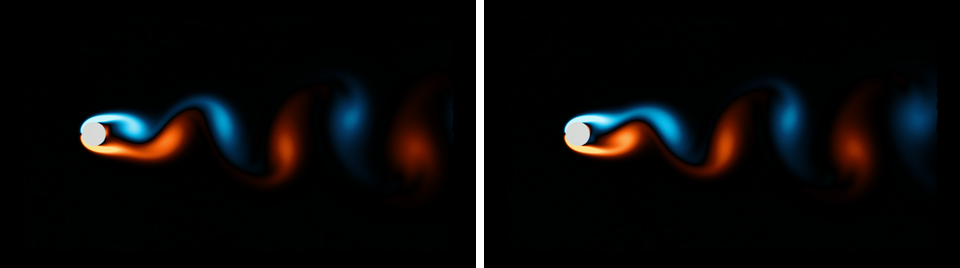

# 2. A shot that moves

Write `shots/wake.yml`:

```yaml
name: wake
source: plt:../data/cylinder_re100
time: {keys: [[0, 4000], [100, 4100], [220, 4160]]}   # then four frames a step: half speed
camera: {fit: domain, direction_of: main}
size: [1280, 720]
layers:
  - {type: slice, normal: z, position: 0.0, field: vorticity_z, range: [-3, 3]}
  - {type: body, body: cylinder, colour: '#c8ccd0'}
```

- **`time: {keys: ...}`** is a time track: frame 0 shows step 4000, frame 100 step
  4100, frame 220 step 4160. In between, each frame shows the saved step nearest the
  time asked, never a blend of two: FlowReel does not make up flow between saved steps
  ([rules](../../guide/projects/rules.md)). The saved steps are 2 apart, so the first 100 frames show
  each for two frames, 0.1 time units a frame, and the last 120 for four: the flow runs
  at half the speed. A track's `ease` shapes the change ([tracks](../../guide/shots/tracks.md)).
- **`camera: {fit: domain, direction_of: main}`** frames the whole near wake to the
  shot's own shape, looking the way `main` looks, down z
  ([cameras](../../guide/shots/cameras.md)).
- **The slice** is the spanwise vorticity, computed from the velocity.

```text
$ flowreel shot preview shots/wake.yml --every 50
```



Behind the cylinder the shear layers roll up and leave as vortices, orange (turning
anticlockwise) and blue (clockwise) in turn: a Kármán vortex street. Unlike a frozen
shot, every frame reads its own step, so a moving shot takes longer to render; chapter
5 hands that to a cluster.

Next: [the force beside it](03-panel.md).
