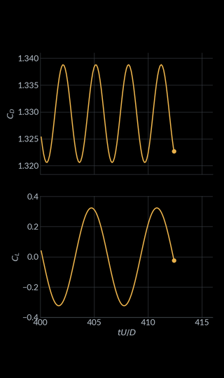

# 3. The force beside it

Make the folder `panels/` and write `panels/force.yml`:

```yaml
type: series
size: [640, 1080]
times: {shot: ../shots/wake.yml}      # the time of each of the shot's frames
x: {label: '$tU/D$'}
rows:
  - label: '$C_D$'
    lines: [{body: cylinder, series: force, column: fx, scale: 2}]   # C = F / (rho U^2 D / 2)
  - label: '$C_L$'
    lines: [{body: cylinder, series: force, column: fy, scale: 2}]
legend: false
```

A `series` panel draws a body's time histories, one row of axes each, on one time
axis ([panels](../../guide/shots/panels.md#series)). Each line runs from the start of the series up
to the frame's time and ends at a dot, so the force is drawn as the flow beside it
moves.

- **`times: {shot: ...}`** gives the panel one frame for each of the shot's frames,
  at the time of the step that frame shows. When the shot slows down, so does the dot.
- **`lines`** name the body and the series declared in the tag's `domain.yml`, and its
  column. The project has one tag, so `cylinder` is enough; with two tags whose bodies
  are both `cylinder`, the lines would say `re100.cylinder`
  ([bodies across tags](../../guide/projects/data.md#shots-and-panels-name-a-tag)).
- **`scale: 2`** turns the force into a coefficient, `C = F / (rho U^2 D / 2)`: the
  record's density, speed and diameter are all 1.

Draw it, to look at it:

```text
$ flowreel panel draw panels/force.yml
```



The lift swings once each time a vortex leaves, and the drag twice, once for each side:
the drag's dot runs through two crests while the lift's runs through one. In the film,
the panel is a box of a scene, drawn by the build at the box's size; `panel draw` is for
looking at it on its own.

Next: [a layout of the two](04-layout.md).
