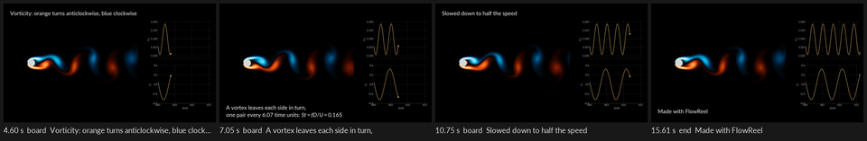

# 4. The film

Write the title card, `cards/title.yml`, crediting the data as its licence asks:

```yaml
blocks:
  - {title: ['Vortex shedding behind a cylinder'], size: 72, y: 380}
  - {divider: 320, gap: 40}
  - {text: ['Reynolds number 100'], size: 34, gap: 40}
  - {text: ['Data: M. Boudina, Polytechnique Montréal (Zenodo 5039610), CC BY 4.0'], size: 24, gap: 150}
```

The board's captions, `text/board.yml`:

```yaml
- lines: ['Vorticity: orange turns anticlockwise, blue clockwise']
  at: [0.4, 2.8]
  place: [60, 70]                     # pixels from the upper left: over the shot's side
  align: left
- lines: ['Slowed down to half the speed']
  at: [6.5, 9.0]
  place: [60, 70]
  align: left
```

A caption is centred across the whole picture by default, and this picture has the
panel on its right, so these are placed by pixels instead: `place: [x, y]` puts the
caption's upper left corner there, and `align: left` lines its lines up on that
edge ([captions](../../guide/old/captions.md)). The freeze's, `text/freeze.yml`, goes under the
shot, which ends at `y = 900`:

```yaml
- lines: ['A vortex leaves each side in turn,', 'one pair every 6.07 time units: $St = fD/U = 0.165$']
  place: [60, 925]                    # under the shot, which ends at y = 900
  align: left
```

And `film.yml`:

```yaml
output: film.mp4
fps: 24
size: [1920, 1080]
shots:
  - {name: title, card: cards/title.yml, seconds: 3, fade: [0.5, 0.5]}
  - name: board                       # 221 frames at 24 a second: 9.2 s, and a 2 s freeze
    frames: frames/board
    fade: [0.5, 0]
    text: text/board.yml
    freezes: [{at: 3.0, hold: 2, text: text/freeze.yml}]
  - name: end
    hold_last_of: board
    seconds: 3
    fade: [0, 1.5]
    text: [{lines: ['Made with FlowReel'], at: [0.3, 2.5], place: [60, 960], align: left}]
```

The board is one folder of frames, as a shot's are: `compose layout` wrote it. The
freeze stops the moving flow at 3 s and holds that frame for 2 s; the board's time after
it moves on by 2 s, so the caption that says the flow has slowed starts at 6.5 s. In
all: 3 + 11.2 + 3 seconds.

```text
$ flowreel film check
$ flowreel film build --preview 540
```



Next: [on a cluster](05-cluster.md).
