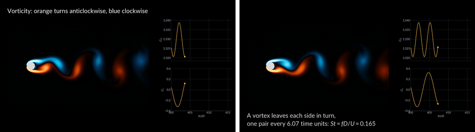

# 4. A layout of the two

The shot and the panel share the frame in one scene: the flow on the left, the force on
the right, the captions over the flow's side. Make the folder `layouts/` and write
`layouts/board.yml`:

```yaml
boxes:
  - name: main                        # 221 frames at 24 a second, and a 2 s freeze
    shot: {file: ../shots/wake.yml, freezes: [{at: 3.0, hold: 2}]}
    pos: [0, 180]
    size: [1280, 720]
  - panel: {file: ../panels/force.yml, freezes: [{at: 3.0, hold: 2}]}   # stops with it
    pos: [1280, 0]
    size: [640, 1080]
  - text: {lines: ['Vorticity: orange turns anticlockwise, blue clockwise'], align: left, valign: top}
    pos: [60, 70]
    at: [0.4, 2.8]
  - text: {lines: ['A vortex leaves each side in turn,', 'one pair every 6.07 time units: $St = fD/U = 0.165$'], align: left, valign: top}
    pos: [60, 925]                    # under the shot, which ends at y = 900
    at: [3.3, 4.8]                    # in the freeze, which runs from 3 to 5
  - text: {lines: ['Slowed down to half the speed'], align: left, valign: top}
    pos: [60, 70]
    at: [6.5, 9.0]
```

- **`pos` and `size`** place a box by pixels of the film, `(0, 0)` at the upper left.
  The shot takes two thirds of the width, 1280 by 720, and is drawn at that size; the
  panel the last third, the full height. (A half or a quarter of the frame is
  `place: left`, `top_right` and so on, and fits a film of any size.)
- **The freezes.** The shot stops 3 s into its frames and holds that frame for 2 s. The
  panel has the same freeze, so its dot stops with the flow; every other box goes on.
  The scene lasts as long as the shot plays: 221 frames, 9.2 s, and the freeze, 11.2 s.
- **The captions** are text boxes at a corner, `pos` alone, as large as their text;
  `align: left` lines their lines up on that edge, and `valign: top` keeps them there.
  Each has its time, in seconds of the scene, freeze included: the one about the
  freeze shows during it, and the one about the slower flow starts at 6.5 s.
- Paths in a layout file are taken from its folder, so the shot is `../shots/wake.yml`.

Now a film file with this scene alone, `film.yml`:

```yaml
output: film.mp4
fps: 24
size: [1920, 1080]
scenes:
  - name: board                       # 9.2 s of frames and a 2 s freeze
    fade: [0.5, 0]
    layout: board                     # layouts/board.yml
```

Render the shot, at the size of its box, and look at the scene:

```text
$ flowreel shot render shots/wake.yml -j 4
$ flowreel scene preview board --at 1.5 4
```



**With a display**, `flowreel scene design board` opens the layout in a window: drag the
captions to where you like them, and the file is written as you go
([designing a layout](../../guide/film/layouts.md#designing-a-layout-scene-design)).

Next: [the film](05-film.md).
