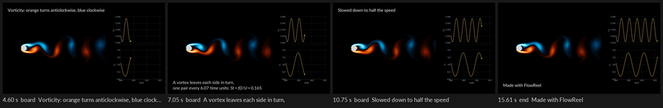

# 5. The film

Write the title, `layouts/title.yml`, crediting the data as its licence asks:

```yaml
boxes:
  - text: {lines: ['Vortex shedding behind a cylinder'], look: title, size: 72, valign: bottom}
    place: top
  - shape: {kind: line, width: 2, colour: '#96a5b2'}
    pos: [810, 538]
    size: [300, 3]
  - text: {lines: ['Reynolds number 100'], look: small, size: 34, valign: top}
    place: bottom
  - text: {lines: ['Data: M. Boudina, Polytechnique Montréal (Zenodo 5039610), CC BY 4.0'], look: small, valign: bottom}
    place: bottom
```

and finish `film.yml` with it and an end:

```yaml
output: film.mp4
fps: 24
size: [1920, 1080]
scenes:
  - name: title
    seconds: 3
    fade: [0.5, 0.5]
    layout: title                     # layouts/title.yml
  - name: board                       # 9.2 s of frames and a 2 s freeze
    fade: [0.5, 0]
    layout: board                     # layouts/board.yml
  - name: end
    seconds: 3
    fade: [0, 1.5]
    layout:
      boxes:
        - last_frame: board
        - text: {lines: ['Made with FlowReel'], align: left, valign: top}
          pos: [60, 960]
          at: [0.3, 2.5]
```

The end holds the board's last frame, with a word under the shot. In all: 3 + 11.2 + 3
seconds.

```text
$ flowreel film check
$ flowreel film build --preview 540
```

`film check` makes the contact sheet, a still at the middle of each caption
([checking the film](../../guide/making/check.md)); `film build` makes the film, a small
copy, and the captions as subtitles ([building the film](../../guide/making/build.md)).



Next: [on a cluster](06-cluster.md).
