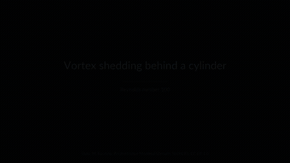

# Second tutorial: a flow that moves

The [first tutorial](../steady/index.md) filmed one steady step. This one films vortex
shedding behind a cylinder at a Reynolds number of 100: a flow that changes from step to
step, with the force on the cylinder drawn beside it as it swings. It reads the flow as
PLT files, and the force from a CSV file, so it shows the way your own simulation's
output comes into FlowReel. It takes about an hour, and the first tutorial is assumed.

The film has three scenes, 17 seconds in all:

1. **The title** (3 s), crediting the data.
2. **The board** (11 s): the vorticity behind the cylinder beside its drag and lift
   coefficients, a line drawn up to the frame's time. The flow runs at one speed, then
   half of it; a freeze stops the flow and the plot together, with a caption.
3. **The end** (3 s): the last picture held, fading out.

## Chapters

1. [The data and its tag](01-data.md): PLT files brought in as a tag, a force series
   in CSV declared under the body.
2. [A shot that moves](02-shot.md): a time track, slowing down.
3. [The force beside it](03-panel.md): a `series` panel.
4. [A layout of the two](04-layout.md): the shot and the panel in one scene, captions
   placed by pixels, a freeze that stops both.
5. [The film](05-film.md): a title, an end, the film checked and built.
6. [On a cluster](06-cluster.md): the render as a Slurm job array.

Every file the tutorial writes is in `examples/tutorial_unsteady/project/`.

## What you need

- FlowReel installed, as in the first tutorial's [chapter 1](../steady/01-install.md).
- 1.2 GB to download and about 1 GB of disk for the converted data. Without the network,
  [a generated stand-in](data.md#getting-it) of the same shape works for every step.
